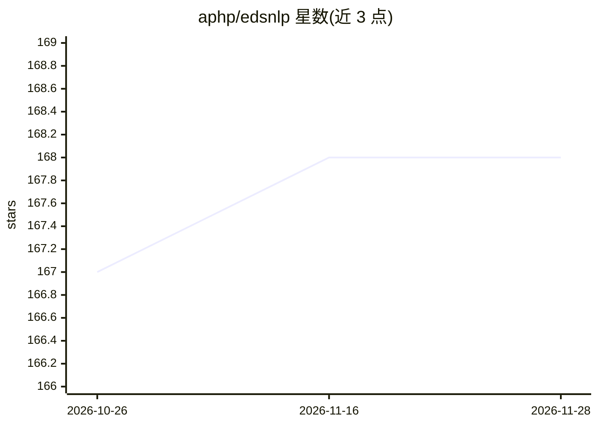

# aphp/edsnlp

⭐ 168 · Python · BSD-3-Clause · 推送 2026-11-26 · [GitHub](https://github.com/aphp/edsnlp) · [官网](https://aphp.github.io/edsnlp/) · 组织维护

**面向法语临床笔记的信息抽取 NLP 框架**

EDS-NLP 是一个 NLP 框架，主要用于从法语临床笔记中抽取信息。核心是一组组件（管道），包括规则组件与深度学习模块，通过模块化管道系统组织为混合多任务模型；使用 spaCy 表示文档与标注，PyTorch 作为可训练组件的后端。规则组件与 spaCy 组件相互兼容，也可用于任意文本。可训练组件涵盖 NER 与 Span 分类，含 LLM 组件与多 GPU 推理；通过 pip 安装，提供交互式 demo 与文档教程。

## 筛选速览

| 维度 | 判定 | 备注 |
|---|---|---|
| AI 角色 | `ai-native` | 本体是模型或模型工具 |
| 许可风险 | `permissive` | BSD-3-Clause |
| 部署形态 | `library` | 以包/库形式分发 |
| 模型依赖 | — | README 未给出锁定关系 |
| 硬件要求 | — | 无带数字的原话,不猜 |
| 安装摩擦 | `low` | 无编译、无系统依赖或容器化 |
| 成熟度 | — | 结构信号不足 |

## 能力要点

- 面向法语临床笔记的规则组件，兼容 spaCy 组件
- 可训练组件：NER、Span 分类，含 LLM 组件与权重共享的多任务模型
- 多 GPU 推理，支持 BRAT/JSON/Parquet/Pandas/Spark 等格式
- spaCy 风格 API，提供交互式 demo

## 适用场景

- 从法语临床文本中抽取实体并判断否定
- 在文本上运行规则与深度学习混合管道
- 处理 BRAT/JSON/Parquet 等格式的文本数据

## 场景标签

 · 领域:自然语言处理/医疗文本挖掘

## 证据(README 行号)

> L10: EDS-NLP is a collaborative NLP framework that aims primarily at extracting information from French clinical notes.
> L12: deep learning modules. These components are organized into a novel efficient and modular pipeline system, built for

## 星数曲线

2026-10-26 167 → 2026-11-28 168（+1）

---
*卡片 v1 · prompt 1.4 · 生成 2026-11-26 · 置信度 high · 依据 README sha `f6eff84e674a` · [字段定义](../../DATASET.md)*
