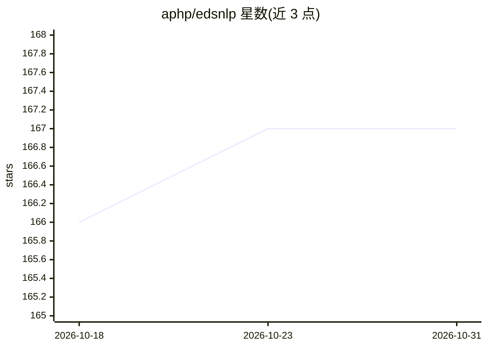

# aphp/edsnlp

⭐ 167 · Python · BSD-3-Clause · 推送 2026-10-28 · [GitHub](https://github.com/aphp/edsnlp) · [官网](https://aphp.github.io/edsnlp/) · 组织维护

**从法语临床病历中抽取信息的模块化 NLP 框架**

EDS-NLP 是面向法语临床笔记信息抽取的协作式 NLP 框架，核心是一组规则或深度学习组件（pipes），组织为支持混合与多任务模型的高效流水线。文档表示使用 spaCy，可训练组件以 Pytorch 为后端；提供 NER、Span 分类、LLM 组件，推理支持多 GPU，兼容 spaCy 规则组件与 BRAT/JSON/Parquet/Pandas/Spark 等 IO 格式。也适用于任意文本文档。由 AP-HP 相关团队维护，pip 安装。

## 筛选速览

| 维度 | 判定 | 备注 |
|---|---|---|
| AI 角色 | `ai-ecosystem` | LLM/agent 周边工具 |
| 许可风险 | `permissive` | BSD-3-Clause |
| 部署形态 | `library` | 以包/库形式分发 |
| 模型依赖 | — | README 未给出锁定关系 |
| 硬件要求 | — | 无带数字的原话,不猜 |
| 安装摩擦 | `low` | 无编译、无系统依赖或容器化 |
| 成熟度 | — | 结构信号不足 |

## 能力要点

- 规则组件与可训练组件（NER、Span 分类）混合的模块化流水线
- 多任务深度学习模型支持权重共享，推理开箱即用多 GPU
- 兼容 spaCy 组件与 spaCy 风格 API
- 支持 BRAT/JSON/Parquet/Pandas/Spark 多种 IO 格式

## 适用场景

- 从法语临床病历中抽取医疗实体与否定等修饰信息
- 构建混合规则与深度学习的多任务 NLP 流水线
- 处理 Parquet/Spark 格式的批量临床文本数据

## 场景标签

`文档解析` · 领域:知识与检索

## 证据(README 行号)

> L10: EDS-NLP is a collaborative NLP framework that aims primarily at extracting information from French clinical notes.
> L12: deep learning modules. These components are organized into a novel efficient and modular pipeline system, built for

## 星数曲线

2026-10-18 166 → 2026-10-31 167（+1）

---
*卡片 v1 · prompt 1.4 · 生成 2026-10-22 · 置信度 high · 依据 README sha `94aa4542bf08` · [字段定义](../../DATASET.md)*
