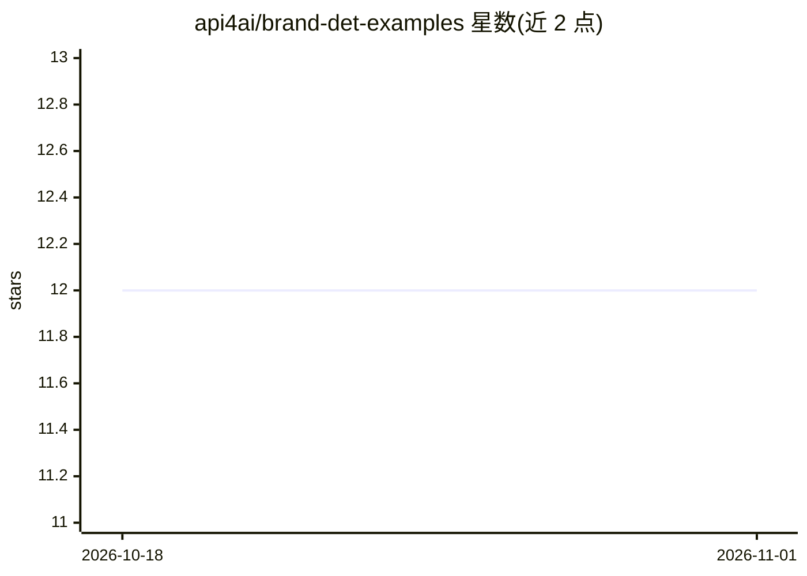

# api4ai/brand-det-examples

⭐ 12 · HTML · MIT · 推送 2026-06-17 · [GitHub](https://github.com/api4ai/brand-det-examples) · [官网](https://api4.ai) · 组织维护

**API4AI 品牌 Logo 识别 API 的多语言示例小程序集**

API4AI 是云端计算机视觉平台，本仓库收录调用其 Brand Recognition API 的即用示例小程序：识别图像中出现的品牌 Logo（覆盖多个行业的数十个品牌），返回图像内品牌 Logo 列表。示例覆盖 Python（requests/aiohttp）、bash curl、C#、Swift、NodeJS、JavaScript、PHP 等语言与技术栈，供 API 注册用户参考集成；API 需通过 API4AI 开发者门户或 RapidAPI 市场使用。

## 筛选速览

| 维度 | 判定 | 备注 |
|---|---|---|
| AI 角色 | `ai-ecosystem` | LLM/agent 周边工具 |
| 许可风险 | `permissive` | MIT |
| 部署形态 | `None` |  |
| 模型依赖 | — | README 未给出锁定关系 |
| 硬件要求 | — | 无带数字的原话,不猜 |
| 安装摩擦 | `low` | 无编译、无系统依赖或容器化 |
| 成熟度 | — | 结构信号不足 |

## 能力要点

- 提供多语言/多技术栈的 API 调用示例（Python/bash/C#/Swift/NodeJS/JS/PHP）
- 识别图像内品牌 Logo 并输出列表
- 可经 Telegram 演示机器人试用 API

## 适用场景

- 我开发应用时需要参考如何调用品牌 Logo 识别 API
- 做营销研究工具时集成品牌识别能力
- 在正式注册前通过 Telegram 机器人试用 API 效果

## 场景标签

`目标检测` · 领域:感知与多模态

## 证据(README 行号)

> L5: API4AI is cloud-native computer vision & AI platform for startups, enterprises and individual developers. This repos
> L11: This project run to help API users with ready-to-use examples in a set of the most popular languages and technologi

## 星数曲线

2026-10-18 12 → 2026-11-01 12（+0）

---
*卡片 v1 · prompt 1.4 · 生成 2026-11-01 · 置信度 mid · 依据 README sha `2ac536fed4a2` · [字段定义](../../DATASET.md)*
