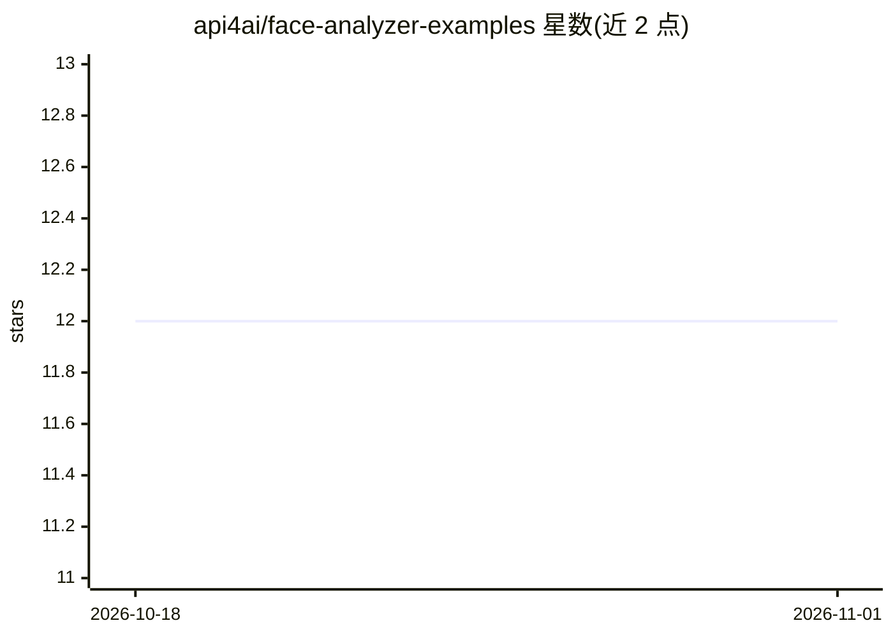

# api4ai/face-analyzer-examples

⭐ 12 · HTML · MIT · 推送 2026-06-17 · [GitHub](https://github.com/api4ai/face-analyzer-examples) · [官网](https://api4.ai) · 组织维护

**API4AI 人脸检测与识别 API 的多语言示例小程序集合**

API4AI 是面向初创公司、企业与个人开发者的云原生计算机视觉平台，本仓库收录调用其 Face Detection & Recognition API 的示例小程序，覆盖 Python（requests/aiohttp）、bash（curl）、C#（RestSharp）、NodeJS/JavaScript（Axios/fetch/jQuery）、PHP（cURL）等多种技术栈。API 能力包括人脸与关键点检测、人脸嵌入向量计算，应用场景为照片应用、安防监控、签证中心等。使用需在 API4AI 开发者门户注册，也可经 RapidAPI 市场或 Telegram 机器人试用。

## 筛选速览

| 维度 | 判定 | 备注 |
|---|---|---|
| AI 角色 | `ai-ecosystem` | LLM/agent 周边工具 |
| 许可风险 | `permissive` | MIT |
| 部署形态 | `None` |  |
| 模型依赖 | — | README 未给出锁定关系 |
| 硬件要求 | — | 无带数字的原话,不猜 |
| 安装摩擦 | `low` | 无编译、无系统依赖或容器化 |
| 成熟度 | — | 结构信号不足 |

## 能力要点

- 覆盖 Python/bash/C#/NodeJS/JavaScript/PHP 多语言调用示例
- 示例演示人脸与关键点检测、人脸嵌入向量计算
- API 可经 RapidAPI 市场与 Telegram 演示机器人试用

## 适用场景

- 我要快速上手调用 API4AI 人脸检测 API
- 为照片应用或安防项目查找多语言接入参考代码
- 在选定技术栈（如 aiohttp 或 Axios）中对照实现 API 调用

## 场景标签

`人脸识别` · 领域:感知与多模态

## 证据(README 行号)

> L5: API4AI is cloud-native computer vision & AI platform for startups, enterprises and individual developers. This repos
> L18: This project run to help API users with ready-to-use examples in a set of the most popular languages and technologi

## 星数曲线

2026-10-18 12 → 2026-11-01 12（+0）

---
*卡片 v1 · prompt 1.4 · 生成 2026-11-01 · 置信度 high · 依据 README sha `4d44d76a4ec1` · [字段定义](../../DATASET.md)*
