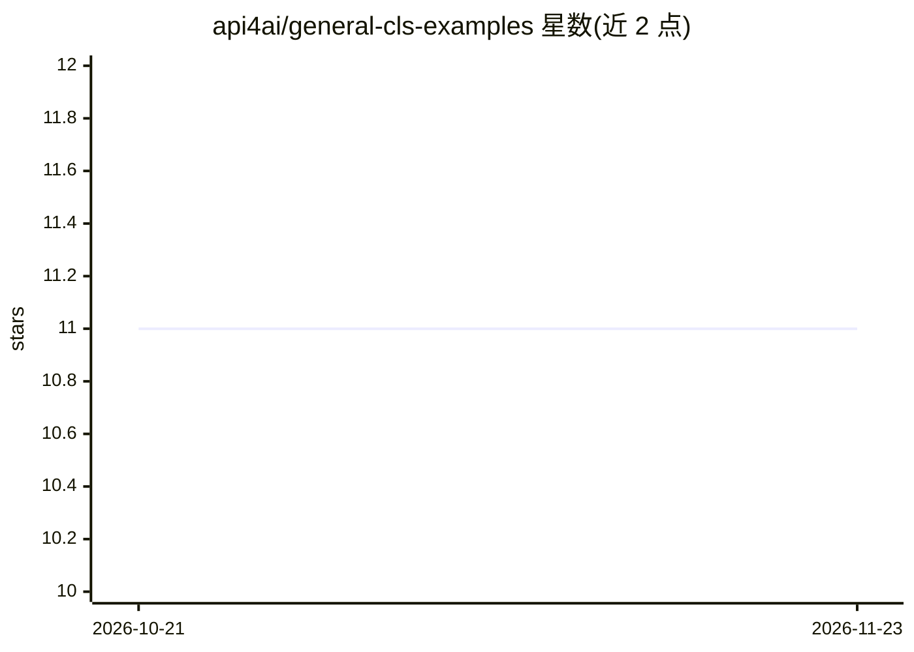

# api4ai/general-cls-examples

⭐ 11 · HTML · MIT · 推送 2026-06-17 · [GitHub](https://github.com/api4ai/general-cls-examples) · [官网](https://api4.ai) · 组织维护

**API4AI 图像分类 API 的多语言调用示例集**

该仓库收录调用 API4AI 云端图像分类（Image Labelling）API 的示例小程序，覆盖 Python（requests/aiohttp）、bash、C#、Swift、NodeJS/JavaScript、PHP 等语言与 HTTP 库。该 API 的模型覆盖约千种对象类别，输出图像标签结果。面向初创公司、企业与个人开发者，适合作为将分类能力集成到自身应用时的入门参考；需在 API4AI 开发者门户注册后使用，另提供 Telegram 演示 bot 与 RapidAPI 市场入口。

## 筛选速览

| 维度 | 判定 | 备注 |
|---|---|---|
| AI 角色 | `ai-native` | 本体是模型或模型工具 |
| 许可风险 | `permissive` | MIT |
| 部署形态 | `None` |  |
| 模型依赖 | — | README 未给出锁定关系 |
| 硬件要求 | — | 无带数字的原话,不猜 |
| 安装摩擦 | `low` | 无编译、无系统依赖或容器化 |
| 成熟度 | — | 结构信号不足 |

## 能力要点

- 9 种语言/库的 HTTP 调用示例（Python、bash、C#、Swift、NodeJS、JavaScript、PHP）
- 模型覆盖约千种对象类别
- 提供 Telegram 演示 bot 与 RapidAPI 市场入口

## 适用场景

- 把通用图像分类能力集成到商业应用
- 社会科学或环境研究中的图像主题标注
- 作为各语言调用 REST 识别 API 的代码参考

## 场景标签

 · 领域:计算机视觉/API 服务

## 证据(README 行号)

> L5: API4AI is cloud-native computer vision & AI platform for startups, enterprises and individual developers. This repos
> L7: The General Classification (Labelling) API offers a complete solution for image classification. Its algorithm is tra
> L13: This project run to help API users with ready-to-use examples in a set of the most popular languages and technologi

## 星数曲线

2026-10-21 11 → 2026-11-23 11（+0）

---
*卡片 v1 · prompt 1.4 · 生成 2026-11-18 · 置信度 high · 依据 README sha `9df99747c790` · [字段定义](../../DATASET.md)*
