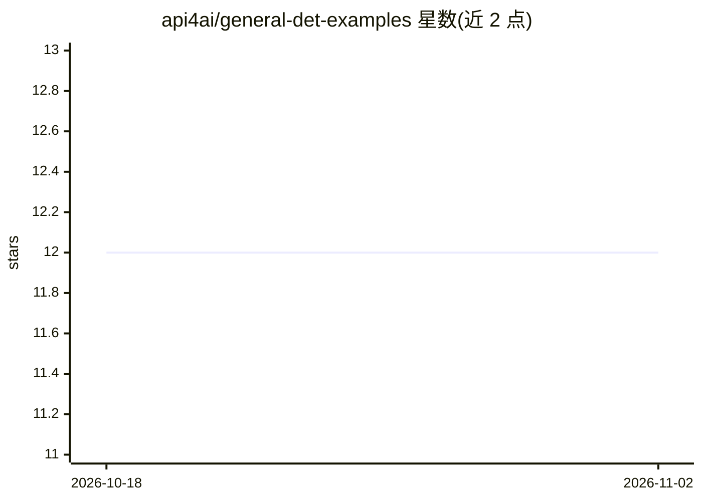

# api4ai/general-det-examples

⭐ 12 · HTML · MIT · 推送 2026-06-17 · [GitHub](https://github.com/api4ai/general-det-examples) · [官网](https://api4.ai) · 组织维护

**API4AI 通用物体检测 API 的多语言示例小程序集**

API4AI 官方维护的示例仓库，演示如何调用其云端 Object Detection API：该 API 提供检测+分类一体方案，输出边界框、预测类别与置信度。示例覆盖 Python（requests/aiohttp）、Bash（curl）、C#（RestSharp）、Swift、NodeJS、Javascript、PHP 等多种语言与技术栈，供已注册 API4AI 服务的开发者快速接入使用；需在 API4AI 开发者门户注册或经 RapidAPI 获取服务。仓库本身不提供安装命令，使用依赖 API4AI 云服务与 API key。

## 筛选速览

| 维度 | 判定 | 备注 |
|---|---|---|
| AI 角色 | `ai-ecosystem` | LLM/agent 周边工具 |
| 许可风险 | `permissive` | MIT |
| 部署形态 | `None` |  |
| 模型依赖 | — | README 未给出锁定关系 |
| 硬件要求 | — | 无带数字的原话,不猜 |
| 安装摩擦 | `low` | 无编译、无系统依赖或容器化 |
| 成熟度 | — | 结构信号不足 |

## 能力要点

- 调用 API4AI 云端 Object Detection API 的示例小程序
- 输出为边界框、预测类别与置信度百分比
- 覆盖 Python/Bash/C#/Swift/NodeJS/Javascript/PHP 多语言示例
- 提供 Telegram 演示机器人与 RapidAPI 渠道

## 适用场景

- 快速上手调用 API4AI 物体检测 API
- 在不同语言项目中参考 API 接入代码
- 通过 Telegram 机器人试用检测效果

## 场景标签

`目标检测` · 领域:感知与多模态

## 证据(README 行号)

> L5: API4AI is cloud-native computer vision & AI platform for startups, enterprises and individual developers. This repos
> L16: This project run to help API users with ready-to-use examples in a set of the most popular languages and technologi

## 星数曲线

2026-10-18 12 → 2026-11-02 12（+0）

---
*卡片 v1 · prompt 1.4 · 生成 2026-11-01 · 置信度 mid · 依据 README sha `c94613dd54c8` · [字段定义](../../DATASET.md)*
