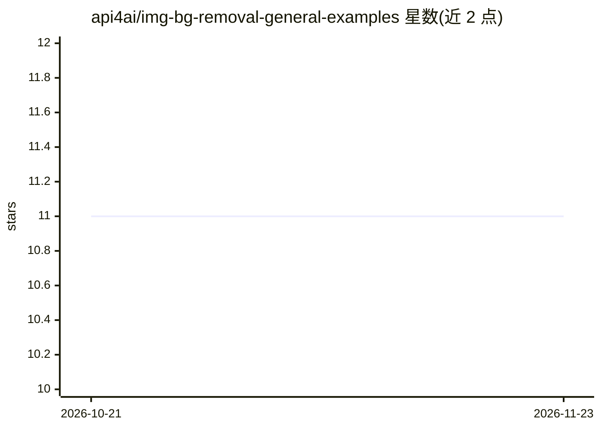

# api4ai/img-bg-removal-general-examples

⭐ 11 · HTML · MIT · 推送 2026-06-17 · [GitHub](https://github.com/api4ai/img-bg-removal-general-examples) · [官网](https://api4.ai) · 组织维护

**API4AI 背景移除 API 的多语言示例代码集**

该仓库包含调用 API4AI 云端背景移除 API 的示例小程序，覆盖 Python（requests/aiohttp）、bash/curl、C#（RestSharp）、Swift（URLSession）、NodeJS（Axios）、JavaScript（fetch/Axios/jQuery）、PHP（cURL）等多种技术栈。API 通过计算前景区域、分割并移除其余像素来处理图像。用户需在 API4AI Developer Portal 注册，也可通过 Telegram demo bot 或 RapidAPI 市场试用。README 未提供本地安装与运行命令，仅给出注册与文档链接。

## 筛选速览

| 维度 | 判定 | 备注 |
|---|---|---|
| AI 角色 | `ai-native` | 本体是模型或模型工具 |
| 许可风险 | `permissive` | MIT |
| 部署形态 | `None` |  |
| 模型依赖 | — | README 未给出锁定关系 |
| 硬件要求 | — | 无带数字的原话,不猜 |
| 安装摩擦 | `low` | 无编译、无系统依赖或容器化 |
| 成熟度 | — | 结构信号不足 |

## 能力要点

- 提供 8 种语言/技术栈的 API 调用示例（Python、bash、C#、Swift、NodeJS、JavaScript、PHP）
- API 计算前景物体/区域并分割移除其余像素
- 提供 Telegram demo bot 与 RapidAPI 市场试用入口

## 适用场景

- 在图像处理应用中调用 API 移除背景
- 快速制作拼贴图
- 集成到社交媒体类应用中处理图片

## 场景标签

`图像视频处理` · 领域:感知与多模态

## 证据(README 行号)

> L5: API4AI is cloud-native computer vision & AI platform for startups, enterprises and individual developers. This repos
> L7: The (General) Background Removal API is as simple as it goes. It calculates a potential foreground object/area, segm

## 星数曲线

2026-10-21 11 → 2026-11-23 11（+0）

---
*卡片 v1 · prompt 1.4 · 生成 2026-11-18 · 置信度 high · 依据 README sha `b1417fff4eb1` · [字段定义](../../DATASET.md)*
