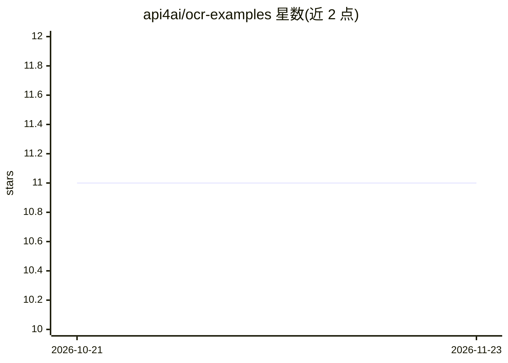

# api4ai/ocr-examples

⭐ 11 · HTML · MIT · 推送 2026-06-17 · [GitHub](https://github.com/api4ai/ocr-examples) · [官网](https://api4.ai) · 组织维护

**API4AI OCR API 的多语言示例应用集合**

API4AI 平台提供的 OCR 文字识别 API 示例代码仓库，包含 Python（requests/aiohttp）、bash（curl）、C#（RestSharp）、Swift（URLSession）、NodeJS、JavaScript（fetch/Axios/jQuery）、PHP 等多种语言的示例小程序。API 返回图像中检测到的文本块边界框与识别文本。使用需在 API4AI Developer Portal 注册，另提供 Telegram 演示机器人与 RapidAPI 市场入口。README 未给出本地安装与部署步骤。

## 筛选速览

| 维度 | 判定 | 备注 |
|---|---|---|
| AI 角色 | `ai-native` | 本体是模型或模型工具 |
| 许可风险 | `permissive` | MIT |
| 部署形态 | `None` |  |
| 模型依赖 | — | README 未给出锁定关系 |
| 硬件要求 | — | 无带数字的原话,不猜 |
| 安装摩擦 | `low` | 无编译、无系统依赖或容器化 |
| 成熟度 | — | 结构信号不足 |

## 能力要点

- 覆盖 Python、bash、C#、Swift、NodeJS、JavaScript、PHP 等多种语言的示例
- OCR API 输出文本块边界框与识别文本
- 提供 Telegram 演示机器人与 RapidAPI 市场入口

## 适用场景

- 学习如何用各语言调用 API4AI 的 OCR API
- 为应用集成图像文字识别功能做参考
- 通过 Telegram 机器人试用 OCR API

## 场景标签

`OCR` · 领域:感知与多模态

## 证据(README 行号)

> L5: API4AI is cloud-native computer vision & AI platform for startups, enterprises and individual developers. This repos
> L7: The Optical Character Recognition (OCR) API provides a complete solution for text recognition in images. The algorit

## 星数曲线

2026-10-21 11 → 2026-11-23 11（+0）

---
*卡片 v1 · prompt 1.4 · 生成 2026-11-18 · 置信度 high · 依据 README sha `9aafba3e5878` · [字段定义](../../DATASET.md)*
