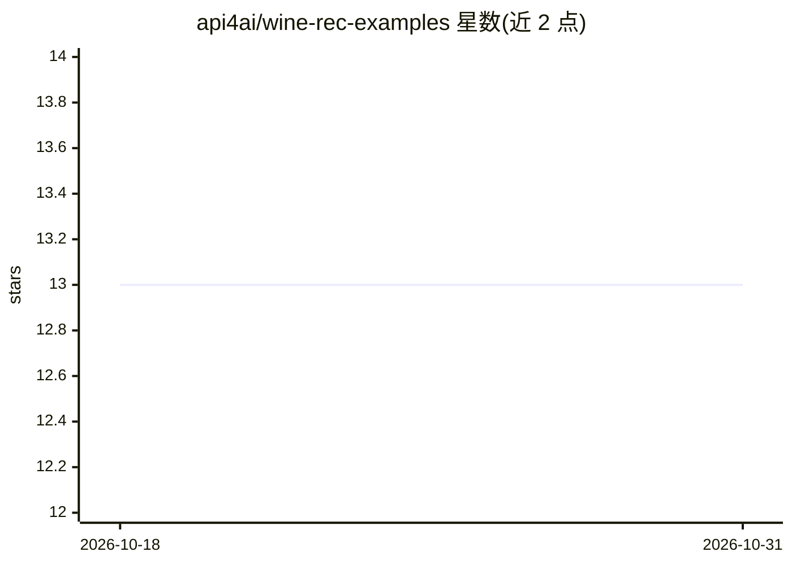

# api4ai/wine-rec-examples

⭐ 13 · HTML · MIT · 推送 2026-06-17 · [GitHub](https://github.com/api4ai/wine-rec-examples) · [官网](https://api4.ai) · 组织维护

**调用 API4AI 葡萄酒标签识别 API 的多语言示例小程序集**

API4AI 官方维护的示例代码仓库：演示如何用多种语言和技术（Python requests/aiohttp、bash curl、C# RestSharp、NodeJS/JavaScript Axios/fetch/jQuery、PHP cURL）调用其云端 Wine Recognition API。该 API 接收 RGB 图像，返回葡萄酒品牌与类型（如 Cabernet Sauvignon/Merlot/Rosé）。README 未给出具体的安装与运行命令，仅提供开发者门户注册、RapidAPI 入口与 Telegram 演示机器人链接。适合需要集成该 API 的开发者参考。

## 筛选速览

| 维度 | 判定 | 备注 |
|---|---|---|
| AI 角色 | `ai-ecosystem` | LLM/agent 周边工具 |
| 许可风险 | `permissive` | MIT |
| 部署形态 | `None` |  |
| 模型依赖 | — | README 未给出锁定关系 |
| 硬件要求 | — | 无带数字的原话,不猜 |
| 安装摩擦 | `low` | 无编译、无系统依赖或容器化 |
| 成熟度 | — | 结构信号不足 |

## 能力要点

- 覆盖 7 种语言/技术栈的 API 调用示例
- 调用的 API 从 RGB 图像返回葡萄酒品牌与类型
- 提供 Telegram 演示机器人与 RapidAPI 入口

## 适用场景

- 集成葡萄酒标签识别 API 前查看各语言调用范例
- 零售或酒类门店应用中接入酒标识别功能时参考实现

## 场景标签

`图像视频处理` · 领域:感知与多模态

## 证据(README 行号)

> L5: API4AI is cloud-native computer vision & AI platform for startups, enterprises and individual developers. This repos
> L11: This project run to help API users with ready-to-use examples in a set of the most popular languages and technologi

## 星数曲线

2026-10-18 13 → 2026-10-31 13（+0）

---
*卡片 v1 · prompt 1.4 · 生成 2026-10-31 · 置信度 high · 依据 README sha `99bbfafaa5d9` · [字段定义](../../DATASET.md)*
