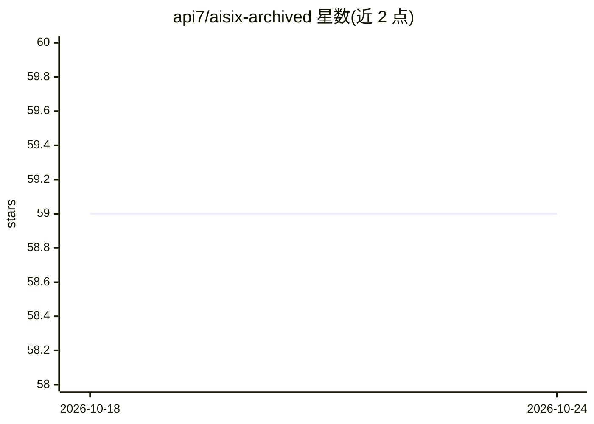

# api7/aisix-archived

⭐ 59 · Rust · Apache-2.0 · 推送 2026-06-15 · [GitHub](https://github.com/api7/aisix-archived) · [官网](https://api7.ai/ai-gateway) · 组织维护

**Rust 编写的 AI 网关与 LLM 代理，统一 OpenAI 兼容 API**

AISIX 是 API7 维护的开源 AI Gateway 与 LLM proxy，用 Rust + Tokio 实现并以单二进制交付。它将 OpenAI、Anthropic、Gemini、DeepSeek 及任意 OpenAI 兼容服务商统一为一套 OpenAI 兼容 API，提供 API key 认证、RPM/TPM/并发等限流、按模型与按 key 访问控制、JSON Schema 请求校验，以及 OpenTelemetry 追踪与 Prometheus 指标。配置经 etcd 热更新，内置 React Admin 面板与 Chat Playground。快速开始脚本通过 Docker Compose 启动。仓库名含 archived 后缀。

## 筛选速览

| 维度 | 判定 | 备注 |
|---|---|---|
| AI 角色 | `ai-ecosystem` | LLM/agent 周边工具 |
| 许可风险 | `permissive` | Apache-2.0 |
| 部署形态 | `self-host` | docker 或自建部署 |
| 模型依赖 | locked-api |  |
| 硬件要求 | — | 无带数字的原话,不猜 |
| 安装摩擦 | `low` | 无编译、无系统依赖或容器化 |
| 成熟度 | — | 结构信号不足 |

## 能力要点

- 多服务商统一为 OpenAI 兼容 API（OpenAI/Anthropic/Gemini/DeepSeek 等）
- etcd 动态配置热更新，无需重启
- 限流（RPM/RPD/TPM/TPD/并发）与按 key 模型白名单
- OpenTelemetry 追踪、Prometheus 指标与内置 Admin UI

## 适用场景

- 团队统一管理多家 LLM 服务商的调用入口与密钥
- 对企业内 LLM 流量做限流、鉴权与按模型访问控制
- 通过网关观测 LLM 调用的追踪与指标

## 场景标签

`模型网关` · 领域:Agent 开发

## 证据(README 行号)

> L6:  An open source, high-performance AI Gateway and LLM proxy built in Rust.
> L7:  Unified OpenAI-compatible API for OpenAI, Anthropic, Gemini, DeepSeek, and any OpenAI-compatible provider.

## 星数曲线

2026-10-18 59 → 2026-10-24 59（+0）

---
*卡片 v1 · prompt 1.4 · 生成 2026-10-24 · 置信度 mid · 依据 README sha `f26a675e563f` · [字段定义](../../DATASET.md)*
