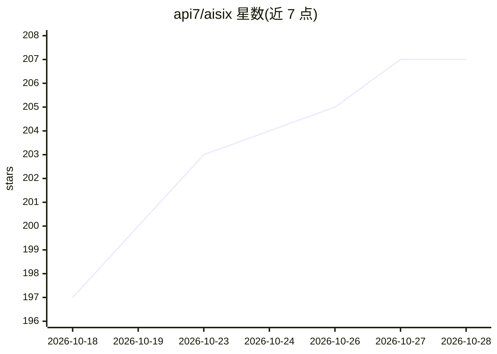

# api7/aisix

⭐ 207 · Rust · Apache-2.0 · 推送 2026-10-27 · [GitHub](https://github.com/api7/aisix) · [官网](https://api7.ai/ai-gateway) · 组织维护 · 中文 README

**Rust 编写的开源 AI 网关：统一 OpenAI 兼容 API 接入多家模型**

面向平台团队的 LLM/AI agent 流量网关，以单一 OpenAI 兼容 API 前置于 OpenAI、Anthropic、Gemini/Vertex、AWS Bedrock、Azure OpenAI、DeepSeek 及任意 OpenAI 兼容端点（含 vLLM、Ollama），通过五类原生适配器族转换协议。内置六种路由策略、限流并发控制、护栏（PII 检测/Presidio/Lakera 等）、缓存、MCP 与 A2A 网关、Prometheus/OTLP 可观测性。以单个静态二进制交付，声明式 resources.yaml 配置，SIGHUP 热加载，可选 etcd 组集群；另有商业版 Enterprise/Cloud 提供控制平面。

## 筛选速览

| 维度 | 判定 | 备注 |
|---|---|---|
| AI 角色 | `ai-ecosystem` | LLM/agent 周边工具 |
| 许可风险 | `permissive` | Apache-2.0 |
| 部署形态 | `None` |  |
| 模型依赖 | local-ok | 支持本地模型 |
| 硬件要求 | — | 无带数字的原话,不猜 |
| 安装摩擦 | `low` | 无编译、无系统依赖或容器化 |
| 成熟度 | — | 结构信号不足 |

## 能力要点

- 五类原生协议适配器族，客户端侧 API 保持 OpenAI 形态
- 六种路由策略（round_robin/failover/least_cost 等）与 ensemble、语义路由
- MCP 网关与 A2A agent 网关（/mcp、/a2a/:agent）
- 单静态二进制 + resources.yaml 声明式配置，SIGHUP 原子热加载

## 适用场景

- 为平台团队统一管理多家 LLM 供应商的流量路由与治理
- 对 LLM 输入输出做护栏过滤与 PII 脱敏
- 多副本集群部署并集中观测 LLM 调用指标与用量

## 场景标签

`模型网关` · 领域:Agent 开发

## 证据(README 行号)

> L3: ### The open-source, Rust-native AI gateway for LLMs and AI agents
> L26: **AISIX OSS** is the open-source product built around the Rust-native AISIX gateway. The
> L29: endpoint. It gives platform teams one place to route, govern, secure, and observe LLM

## 星数曲线

2026-10-18 197 → 2026-10-28 207（+10）

---
*卡片 v1 · prompt 1.4 · 生成 2026-10-22 · 置信度 high · 依据 README sha `4afabed5af34` · [字段定义](../../DATASET.md)*
