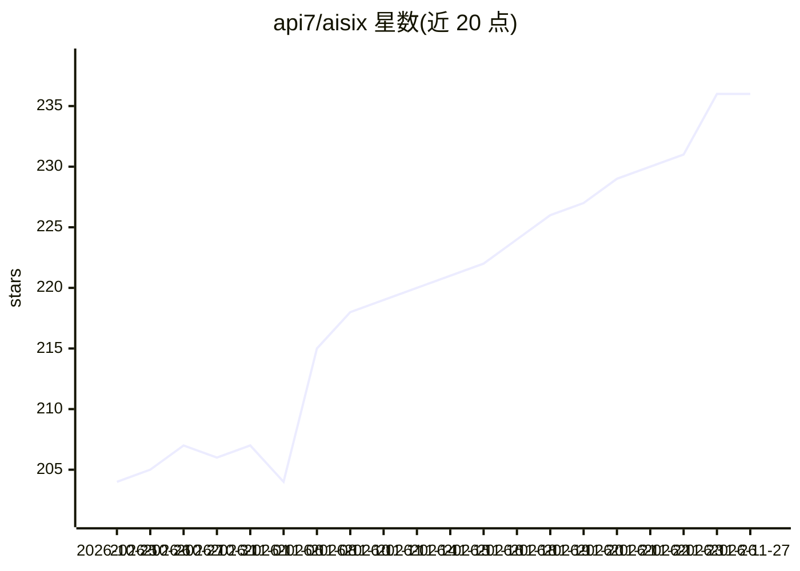

# api7/aisix

⭐ 236 · Rust · Apache-2.0 · 推送 2026-11-26 · [GitHub](https://github.com/api7/aisix) · [官网](https://api7.ai/ai-gateway) · 组织维护

**为平台团队统一管理 LLM 与 Agent 流量的开源 Rust 网关**

以单个静态二进制运行的 AI 网关，在多家模型服务商前提供统一的 OpenAI 兼容 API：路由与故障转移、限流与并发控制、护栏、缓存、API key/OIDC 认证及可观测性（Prometheus/OTLP）。配置通过 resources.yaml 声明并支持 SIGHUP 热重载，或多副本场景接入 etcd；无控制平面、无数据库即可运行。同一网关二进制也是商业版 AISIX Enterprise/Cloud 的数据平面，预算与花费上限为商业版功能。

## 筛选速览

| 维度 | 判定 | 备注 |
|---|---|---|
| AI 角色 | `ai-ecosystem` | LLM/agent 周边工具 |
| 许可风险 | `permissive` | Apache-2.0 |
| 部署形态 | `None` |  |
| 模型依赖 | local-ok | 支持本地模型 |
| 硬件要求 | — | 无带数字的原话,不猜 |
| 安装摩擦 | `low` | 无编译、无系统依赖或容器化 |
| 成熟度 | — | 结构信号不足 |

## 能力要点

- OpenAI 与 Anthropic 两种线格式接入，翻译到任意已配置上游
- 六种路由策略与 Ensemble 模型、语义路由
- MCP 与 A2A agent 网关（/mcp、/a2a/:agent）
- 声明式 resources.yaml 配置，SIGHUP 热重载或 etcd 多副本

## 适用场景

- 用统一入口与认证管理团队的全部 LLM 调用流量
- 多模型间做路由、故障转移与成本/延迟优先调度
- 为 LLM 流量加内容护栏、限流与响应缓存
- 以网关代理 MCP 服务器与 A2A agent 并控制访问

## 场景标签

`模型网关` · 领域:Agent 开发

## 证据(README 行号)

> L5: **One OpenAI-compatible API in front of every model.** Route, govern, secure, cache, and
> L29: endpoint. It gives platform teams one place to route, govern, secure, and observe LLM
> L146: - **MCP gateway** — front registered upstream MCP servers at `/mcp` with gateway-held

## 星数曲线

2026-10-25 204 → 2026-11-27 236（+32）

---
*卡片 v1 · prompt 1.4 · 生成 2026-11-26 · 置信度 high · 依据 README sha `5fe4535e97bd` · [字段定义](../../DATASET.md)*
