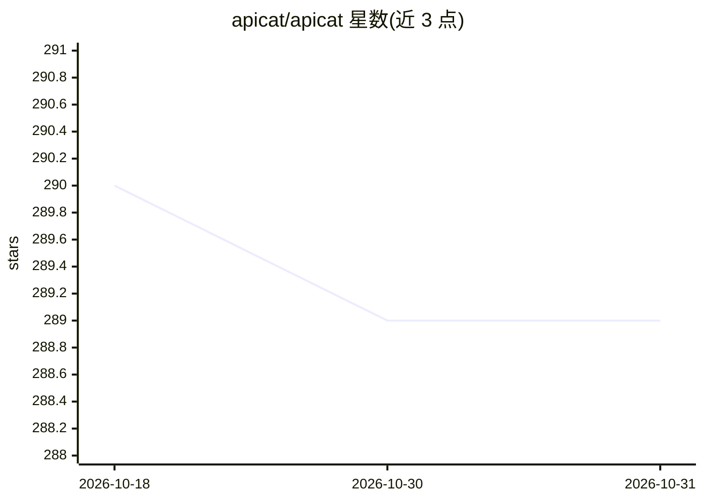

# apicat/apicat

⭐ 289 · Go · 推送 2026-10-30 · [GitHub](https://github.com/apicat/apicat) · [官网](https://apicat.ai) · 组织维护 · 中文 README

**兼容 OpenAPI 的 API 文档管理工具，内置 LLM 生成能力**

ApiCat 是一个完全兼容 OpenAPI 规范的 API 文档管理工具，面向开发者提供 API 的管理与维护能力。其集成了 LLM：可根据已有内容自动生成 API 文档与数据模型，并基于 API 内容生成对应测试用例。部署方式上提供云端服务（与自部署版功能一致），也可通过 Docker Compose 在本地运行，启动后访问 localhost:8000 即可使用；自定义配置需修改 docker-compose.yml 中的环境变量。项目以 MIT 许可发布。

## 筛选速览

| 维度 | 判定 | 备注 |
|---|---|---|
| AI 角色 | `ai-enhanced` | 去掉 AI 部分产品仍成立 |
| 许可风险 | `none` | — |
| 部署形态 | `self-host` | docker 或自建部署 |
| 模型依赖 | — | README 未给出锁定关系 |
| 硬件要求 | — | 无带数字的原话,不猜 |
| 安装摩擦 | `low` | 无编译、无系统依赖或容器化 |
| 成熟度 | — | 结构信号不足 |

## 能力要点

- 完全兼容 OpenAPI 规范的 API 文档管理
- LLM 自动生成 API 文档与数据模型
- 基于 API 内容生成对应测试用例
- 提供 Docker Compose 本地部署与云端服务两种方式

## 适用场景

- 团队管理 API 文档并保持 OpenAPI 兼容
- 借助 LLM 快速生成数据模型与测试用例
- 通过 Docker Compose 自部署 API 文档平台

## 场景标签

`代码生成` · 领域:编码与开发

## 证据(README 行号)

> L16: ApiCat is an API documentation management tool that is fully compatible with the OpenAPI specification. With ApiCat

## 星数曲线

2026-10-18 290 → 2026-10-31 289（-1）

---
*卡片 v1 · prompt 1.4 · 生成 2026-10-23 · 置信度 mid · 依据 README sha `da629af44d3a` · [字段定义](../../DATASET.md)*
