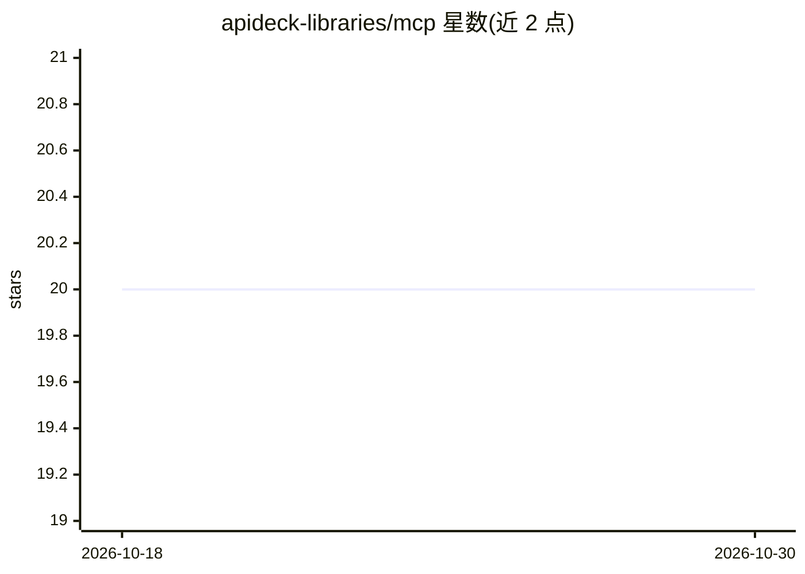

# apideck-libraries/mcp

⭐ 20 · Dockerfile · MIT · 推送 2026-10-22 · [GitHub](https://github.com/apideck-libraries/mcp) · [官网](https://mcp.apideck.dev/mcp) · 组织维护

**连接 200+ SaaS 连接器的 Apideck MCP 服务器，供 agent 调用**

Apideck Unified API 的 Model Context Protocol 服务器：向任意 MCP 兼容 agent 暴露 330 个工具，覆盖会计、CRM、HRIS、文件存储、ATS、电商等 10 类统一 API，另有 4 个聚合多次调用的 workflow 工具。提供三种模式（dynamic 渐进发现省 token / static 全量 / code 沙箱 JS 执行）、read/write/destructive 作用域过滤、consumer 级身份作用域与锁定、JWT 会话认证。安装途径包括 Claude Desktop .mcpb 预构建包、npx 本地 stdio、托管 HTTP 端点 mcp.apideck.dev，需 Apideck API key。运行时对 5xx/网络错误做指数退避重试（仅幂等方法）。

## 筛选速览

| 维度 | 判定 | 备注 |
|---|---|---|
| AI 角色 | `ai-ecosystem` | LLM/agent 周边工具 |
| 许可风险 | `permissive` | MIT |
| 部署形态 | `library` | 以包/库形式分发 |
| 模型依赖 | — | README 未给出锁定关系 |
| 硬件要求 | — | 无带数字的原话,不猜 |
| 安装摩擦 | `low` | 无编译、无系统依赖或容器化 |
| 成熟度 | — | 结构信号不足 |

## 能力要点

- 330 个工具覆盖 10 类统一 API，另含 4 个聚合式 workflow 工具
- dynamic/static/code 三种暴露模式，dynamic 模式声明约省 85% 初始 token
- 作用域过滤（read/write/destructive）与 consumer 身份锁定、JWT Vault 会话认证
- 提供 .mcpb 预构建包、npx stdio 与托管 HTTP 三种接入方式

## 适用场景

- 让 Claude/Cursor 等 MCP agent 直接读写我的会计、CRM、HRIS 数据
- 通过统一 API 一次接入 200+ SaaS 连接器而无需逐家开发
- 在 token 敏感的 agent 场景下用 dynamic 模式渐进发现工具

## 场景标签

`工作流自动化` · 领域:效率与自动化

## 证据(README 行号)

> L9: Model Context Protocol server for the Apideck Unified API. Connect any MCP-compatible agent to 200+ connectors — acc
> L101: **330 tools** across 10 unified APIs:

## 星数曲线

2026-10-18 20 → 2026-10-30 20（+0）

---
*卡片 v1 · prompt 1.4 · 生成 2026-10-28 · 置信度 high · 依据 README sha `508f9755749a` · [字段定义](../../DATASET.md)*
