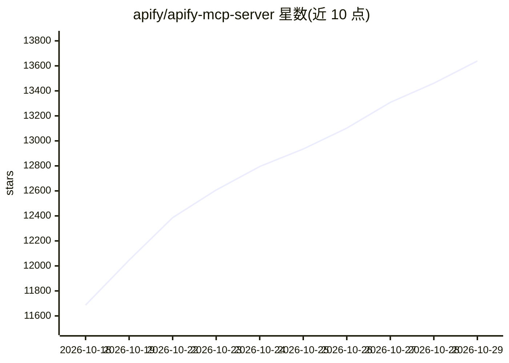

# apify/apify-mcp-server

⭐ 13,639 · TypeScript · MIT · 推送 2026-10-28 · [GitHub](https://github.com/apify/apify-mcp-server) · [官网](https://mcp.apify.com) · 组织维护

**让 AI agent 通过 MCP 调用 Apify 爬虫/数据提取工具的服务器**

Apify 官方维护的 Model Context Protocol 服务器，将 Apify Store 中数千个爬虫、数据提取与自动化 Actor 暴露为 AI agent 可调用的工具，覆盖社交媒体、搜索引擎、地图、电商等网站数据提取。提供托管端点 mcp.apify.com（OAuth/Bearer Token 接入）与本地 stdio 运行（npx）两种方式；加载 Actor 的输入 schema 动态生成 MCP 工具，另提供 Actor 搜索、运行管理、存储访问、定时任务等辅助工具，并支持 AGI/x402/Skyfire 三种 agentic 支付方式。兼容 Claude Desktop、ChatGPT、Cursor、VS Code 等 MCP 客户端。

## 筛选速览

| 维度 | 判定 | 备注 |
|---|---|---|
| AI 角色 | `ai-ecosystem` | LLM/agent 周边工具 |
| 许可风险 | `permissive` | MIT |
| 部署形态 | `self-host` | docker 或自建部署 |
| 模型依赖 | — | README 未给出锁定关系 |
| 硬件要求 | — | 无带数字的原话,不猜 |
| 安装摩擦 | `low` | 无编译、无系统依赖或容器化 |
| 成熟度 | — | 结构信号不足 |

## 能力要点

- 数千个 Apify Actor 可作为 MCP 工具被 AI agent 调用
- 托管端点（OAuth）与本地 stdio 两种接入方式
- 动态工具发现：按 Actor 输入 schema 自动生成 MCP 工具
- 支持 AGI/x402/Skyfire 三种 agent 支付方式

## 适用场景

- 让 Claude/ChatGPT 等 AI 助手抓取社交媒体、地图、搜索引擎数据
- 为 AI agent 提供网页抓取与内容提取能力
- 通过 agent 支付按次运行 Actor 而无需 Apify 账号

## 场景标签

`网页抓取` · 领域:效率与自动化

## 证据(README 行号)

> L33: The Apify MCP Server allows an AI assistant to use any Apify Actor as a tool to perform a specific task.
> L182: Any Apify Actor can be used as a tool.
> L184: The MCP server loads an Actor's input schema and creates a corresponding MCP tool.

## 星数曲线

2026-10-18 11,687 → 2026-10-29 13,639（+1,952）

---
*卡片 v1 · prompt 1.4 · 生成 2026-10-20 · 置信度 mid · 依据 README sha `86d7bc1f3ccc` · [字段定义](../../DATASET.md)*
