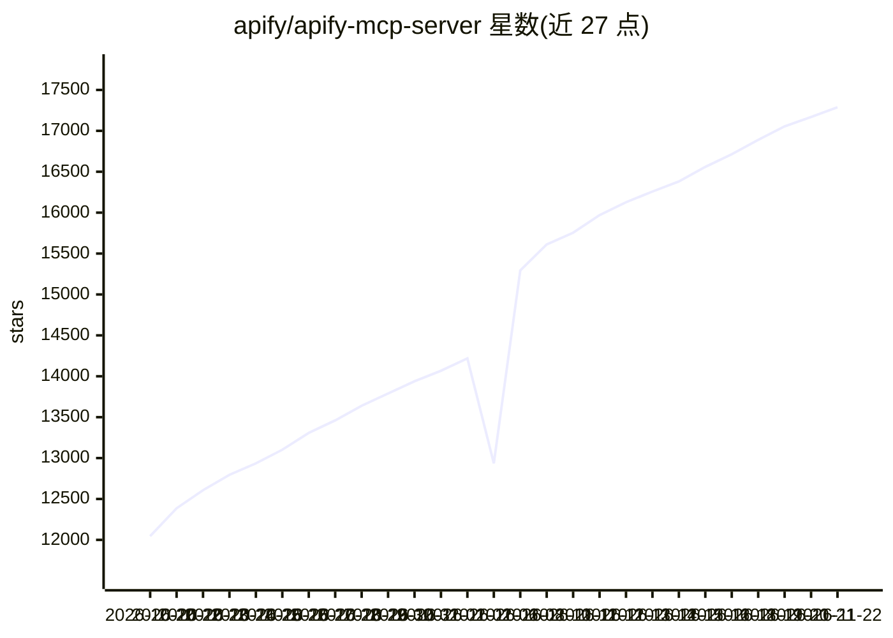

# apify/apify-mcp-server

⭐ 17,289 · TypeScript · MIT · 推送 2026-11-20 · [GitHub](https://github.com/apify/apify-mcp-server) · [官网](https://mcp.apify.com) · 组织维护

**把 AI agent 连接到 Apify Store 数千爬虫工具的 MCP 服务器**

Apify 官方 Model Context Protocol 服务器，托管端点为 https://mcp.apify.com，也可通过 npm 包 @apify/actors-mcp-server 在本地以 stdio 运行。agent 通过 search-actors、fetch-actor-details、call-actor、get-dataset-items 四步流程在 Apify Store 中检索 Actor、查看输入与定价、运行并读取结构化结果；另提供文档检索、运行与存储读取、任务调度管理等辅助工具。托管版支持 OAuth 或 Bearer token 认证，本地版需 Node.js 22+ 与 APIFY_TOKEN。工具按类别或名称可选加载，默认仅启用 actors 与 docs 类别。

## 筛选速览

| 维度 | 判定 | 备注 |
|---|---|---|
| AI 角色 | `ai-ecosystem` | LLM/agent 周边工具 |
| 许可风险 | `permissive` | MIT |
| 部署形态 | `library` | 以包/库形式分发 |
| 模型依赖 | locked-api |  |
| 硬件要求 | — | 无带数字的原话,不猜 |
| 安装摩擦 | `low` | 无编译、无系统依赖或容器化 |
| 成熟度 | — | 结构信号不足 |

## 能力要点

- 一个连接即可调用 Apify Store 中数千个爬虫/自动化 Actor 工具
- 托管（Streamable HTTP+OAuth）与本地 stdio 两种运行模式
- 提供 search-actors/fetch-actor-details/call-actor/get-dataset-items 工具链
- 可按 tools 参数或 --tools 标志选择加载的工具集

## 适用场景

- 让 agent 抓取社交媒体、搜索引擎、地图与电商数据
- 为 RAG 抓取网页内容（rag-web-browser Actor）
- 在不为每个站点单独装 MCP 服务器的情况下扩展 agent 的网络工具
- 用 apify mcp install 一条命令为多个编码 agent 配置 MCP

## 场景标签

`网页抓取` · 领域:效率与自动化

## 证据(README 行号)

> L19: **The official Apify Model Context Protocol (MCP) server gives AI agents web scraping, data extraction, and browser
> L23: Your agent searches Apify Store, checks an Actor's input and pricing, runs it, and reads the structured results, so
> L139: Actors are serverless programs on the Apify platform. Each one does a specific job, like scraping Google Maps, cra

## 星数曲线

2026-10-20 12,046 → 2026-11-22 17,289（+5,243）

---
*卡片 v1 · prompt 1.4 · 生成 2026-11-22 · 置信度 high · 依据 README sha `cb0310335d08` · [字段定义](../../DATASET.md)*
