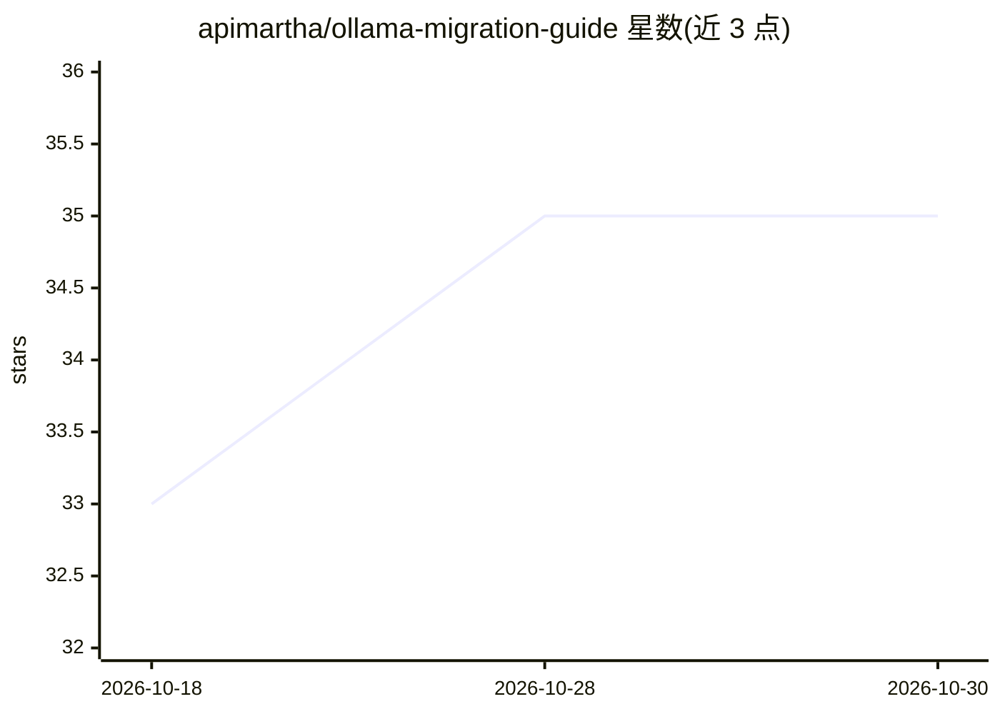

# apimartha/ollama-migration-guide

⭐ 35 · Python · NOASSERTION · 推送 2026-10-12 · [GitHub](https://github.com/apimartha/ollama-migration-guide) · [官网](https://go.apimart.ai/k-a6d50e) · 组织维护 · 中文 README

**通过 APIMart 网关调用 SkyReels V4 视频模型的接口文档**

APIMart 维护的模型调用文档仓库：说明如何经 OpenAI 兼容端点 https://api.apimart.ai/v1 调用 Skywork 的 SkyReels V4 视频生成模型（1080p/32FPS/最长15秒），覆盖模型 id、路由、请求参数、按生成秒计费与失败退款机制，附 curl 与 Python 快速开始示例及 examples 目录。仓库声明为第三方模型文档，不代表官方；出站链接经推广链接 API 生成并由 CI 校验。

## 筛选速览

| 维度 | 判定 | 备注 |
|---|---|---|
| AI 角色 | `ai-knowledge` | 知识聚合/清单类 |
| 许可风险 | `none` | NOASSERTION |
| 部署形态 | `None` |  |
| 模型依赖 | — | README 未给出锁定关系 |
| 硬件要求 | — | 无带数字的原话,不猜 |
| 安装摩擦 | `low` | 无编译、无系统依赖或容器化 |
| 成熟度 | — | 结构信号不足 |

## 能力要点

- OpenAI 兼容端点统一接入 SkyReels V4 与 300+ 模型
- 按生成秒计费，响应内返回 cost 字段，失败任务退款
- 异步任务设计：提交后以 task_id 轮询状态
- 提供 curl/Python 快速开始与 examples 目录

## 适用场景

- 开发者在 APIMart 上接入 SkyReels V4 视频生成
- 查询该模型的计费方式与请求参数
- 复用示例代码快速搭建视频生成轮询流程

## 场景标签

`视频生成` · 领域:内容生成

## 证据(README 行号)

> L1: # SkyReels V4 Prompts — 8 Tested Recipes With Outputs
> L94: SkyReels V4 is a third-party model served through APIMart; this repository documents how to call it and publishes

## 星数曲线

2026-10-18 33 → 2026-10-30 35（+2）

---
*卡片 v1 · prompt 1.4 · 生成 2026-10-25 · 置信度 mid · 依据 README sha `a6c03d6b9b97` · [字段定义](../../DATASET.md)*
