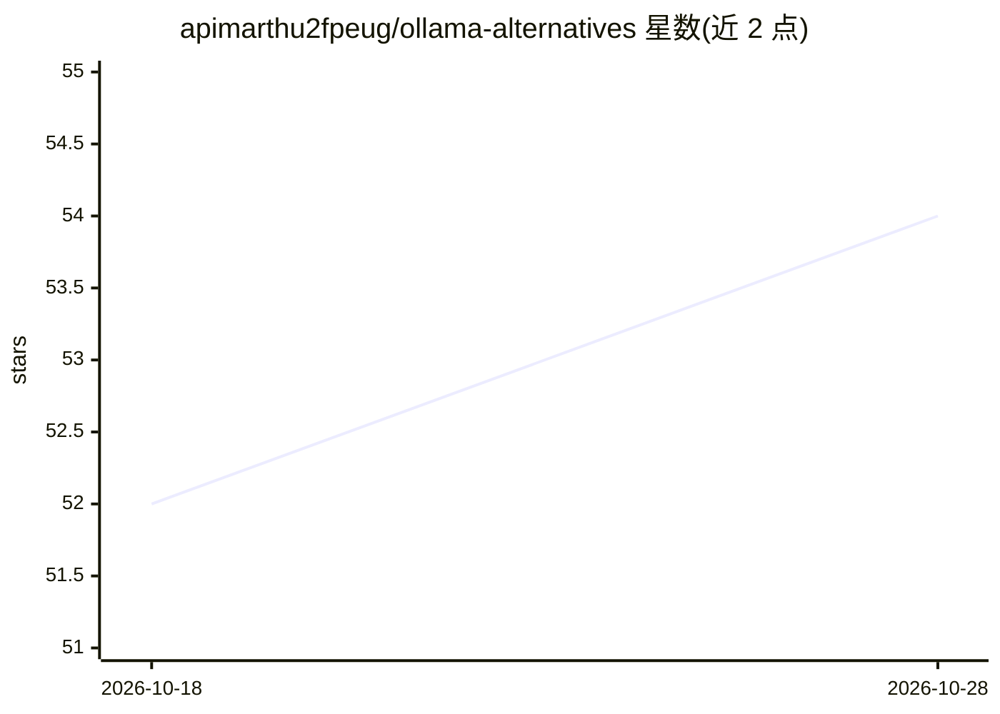

# apimarthu2fpeug/ollama-alternatives

⭐ 54 · Python · NOASSERTION · 推送 2026-10-28 · [GitHub](https://github.com/apimarthu2fpeug/ollama-alternatives) · [官网](https://go.apimart.ai/k-b317c6) · 组织维护

**APIMart 商业 API 网关的 Nano Banana Pro 接入文档与价格页**

APIMart 运营的 API 聚合网关的单模型文档仓库：说明如何通过同一 OpenAI 兼容端点（https://api.apimart.ai/v1）调用 Google 的 Gemini 3 Pro Image 模型（gemini-3-pro-image-preview），按张计费（1K $0.0375 / 4K $0.05，另有按百万 token 计费的官方路径），$1 起充值、按量结算、失败退款。提供 curl 与 Python 示例、请求参数表（分辨率/参考图/NSFW 审核）与异步任务轮询生命周期。仓库自述为第三方转发，不主张官方地位；价格由 CI 刷新快照。

## 筛选速览

| 维度 | 判定 | 备注 |
|---|---|---|
| AI 角色 | `ai-ecosystem` | LLM/agent 周边工具 |
| 许可风险 | `none` | NOASSERTION |
| 部署形态 | `None` |  |
| 模型依赖 | — | README 未给出锁定关系 |
| 硬件要求 | — | 无带数字的原话,不猜 |
| 安装摩擦 | `low` | 无编译、无系统依赖或容器化 |
| 成熟度 | — | 结构信号不足 |

## 能力要点

- 单一 OpenAI 兼容端点与 API key 覆盖 300+ 图像/视频/语言模型
- 按张计费，任务响应内含 cost 字段，失败任务退款
- 异步任务模型：POST 提交后以 task_id 轮询 GET /v1/tasks/{id}
- 可选 omni-moderation-latest 前置内容审核参数

## 适用场景

- 不想申请官方 key，用统一端点调用 Nano Banana Pro 图像生成
- 同一客户端在多个模型间切换（改 model 字段）
- 小额按量付费试用 4K 图像生成与编辑

## 场景标签

`模型网关` `图像生成` · 领域:Agent 开发

## 证据(README 行号)

> L13: - **One key, entire catalog.** The same `https://api.apimart.ai/v1` base URL and `Authorization` header reach Nano 
> L26: Endpoint: `POST https://api.apimart.ai/v1/images/generations` (OpenAI-compatible), then poll `GET /v1/tasks/{task_i

## 星数曲线

2026-10-18 52 → 2026-10-28 54（+2）

---
*卡片 v1 · prompt 1.4 · 生成 2026-10-24 · 置信度 high · 依据 README sha `827ce7e01fba` · [字段定义](../../DATASET.md)*
