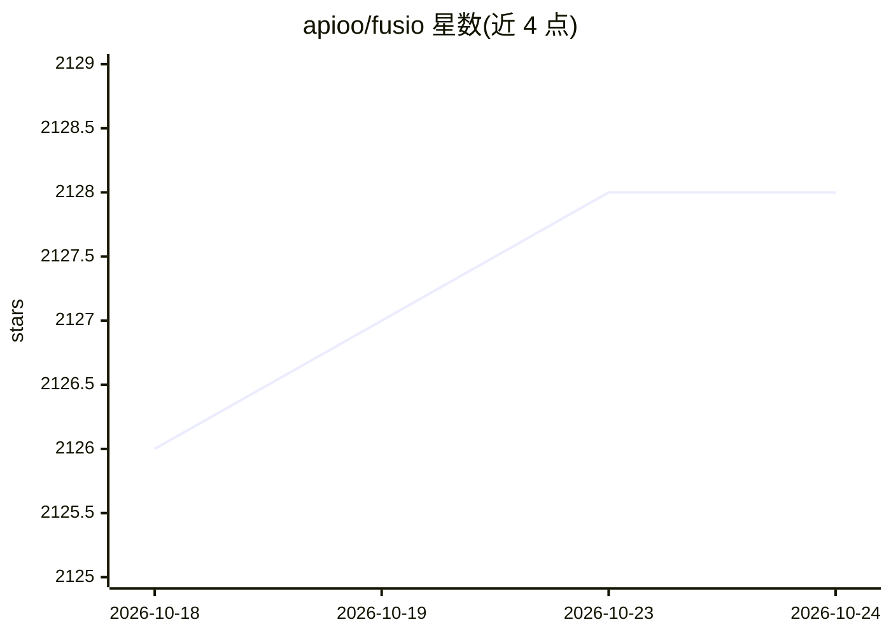

# apioo/fusio

⭐ 2,127 · PHP · Apache-2.0 · 推送 2026-10-21 · [GitHub](https://github.com/apioo/fusio) · [官网](https://www.fusio-project.org) · 个人维护

**自托管 PHP API 管理平台：把业务逻辑变成 API 产品并接入 AI 生态**

用 PHP 编写的自托管后端平台与 API 网关，可将 SQL/NoSQL 数据库直接暴露为 REST API、路由与编排微服务、以 PHP/JavaScript/Python Action 编写自定义业务逻辑，并配套开发者门户、多语言 SDK 生成、订阅计费与分析监控。7.0 起提供 Agent 概念，可用自然语言生成 worker action，支持 Ollama、ChatGPT、Gemini 等多种提供方；原生支持 MCP，可将 API 作为工具暴露给自主 agent。安装途径含 Docker 镜像、手动部署与 Web 安装脚本，需配置 MySQL/PostgreSQL/SQLite 之一。

## 筛选速览

| 维度 | 判定 | 备注 |
|---|---|---|
| AI 角色 | `ai-ecosystem` | LLM/agent 周边工具 |
| 许可风险 | `permissive` | Apache-2.0 |
| 部署形态 | `self-host` | docker 或自建部署 |
| 模型依赖 | local-ok | 支持本地模型 |
| 硬件要求 | — | 无带数字的原话,不猜 |
| 安装摩擦 | `low` | 无编译、无系统依赖或容器化 |
| 成熟度 | — | 结构信号不足 |

## 能力要点

- 将 MySQL/PostgreSQL 等数据库即时暴露为 REST API
- 原生 MCP 支持，可将后端逻辑作为工具提供给 AI agent
- AI Agent 以自然语言生成 worker action（支持 Ollama/ChatGPT/Gemini）
- 开发者门户、SDK 自动生成与订阅计费、分析监控

## 适用场景

- 把遗留数据库或微服务封装为对外 API 产品
- 为自己的 API 建开发者门户、生成 SDK 并做订阅计费
- 通过 MCP 让 AI agent 调用我的后端逻辑
- 用自然语言描述并生成后端 action 代码

## 场景标签

`代码生成` · 领域:编码与开发

## 证据(README 行号)

> L14: Fusio is a self-hosted, open-source backend platform and API gateway written in PHP that bridges the gap between yo
> L17: product, complete with an automated developer portal, SDK generation, and monetization tools. With native MCP suppo
> L28: * **MCP Integration** - Native support for the Model Context Protocol to expose APIs to AI ecosystems.

## 星数曲线

2026-10-18 2,126 → 2026-10-24 2,128（+2）

---
*卡片 v1 · prompt 1.4 · 生成 2026-10-21 · 置信度 mid · 依据 README sha `b9765a727510` · [字段定义](../../DATASET.md)*
