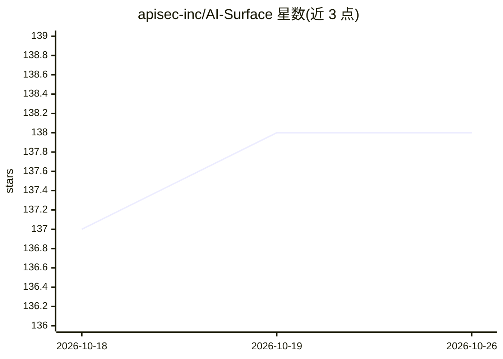

# apisec-inc/AI-Surface

⭐ 138 · Python · MIT · 推送 2026-10-08 · [GitHub](https://github.com/apisec-inc/AI-Surface) · [官网](https://apisec.ai) · 组织维护

**扫描代码库中 AI 攻击面的本地静态分析工具，PR 时与编码工具内可用**

面向 DevSecOps/AppSec/平台工程的 CLI 安全扫描器：静态识别代码库中八类 AI 面（LLM 调用点、agent 框架、MCP 服务器、RAG/向量库、模型网关、AI 基础设施清单、provider 密钥名、HTTP API），生成 AI-BOM 与评分卡，发现项映射 OWASP LLM Top 10 与 EU AI Act/NIST/ISO 42001 条款。支持基线对比与 --fail-on 门禁、GitHub Action、pre-commit、MCP 服务器与 Claude Code hook。全程离线、不执行代码、不读取密钥值；运行时漏洞验证不在范围内，深审严重级目前仅覆盖 MCP/agent/RAG 三类发现。

## 筛选速览

| 维度 | 判定 | 备注 |
|---|---|---|
| AI 角色 | `ai-ecosystem` | LLM/agent 周边工具 |
| 许可风险 | `permissive` | MIT |
| 部署形态 | `self-host` | docker 或自建部署 |
| 模型依赖 | — | README 未给出锁定关系 |
| 硬件要求 | — | 无带数字的原话,不猜 |
| 安装摩擦 | `low` | 无编译、无系统依赖或容器化 |
| 成熟度 | — | 结构信号不足 |

## 能力要点

- 八类 AI 攻击面静态检测（13 家 LLM SDK 调用点、11+7 个 agent 框架、13 个向量库）
- AI-BOM 输出映射 OWASP LLM Top 10 / EU AI Act / NIST AI RMF / ISO 42001
- 基线快照 + --fail-on high 的 PR 门禁，ai-surface init 一条命令生成 CI 工作流
- MCP 服务器与 Claude Code hook：AI 写码时即时标记新增攻击面并确认修复

## 适用场景

- 在 PR 合并前拦截新增的高风险 AI 面（如无审批的金融工具）
- 从源码构建 AI-BOM 与 AI 治理合规证据
- 在 Claude Code/Cursor 等 AI 编码工具内实时查看改动暴露的 AI 面

## 场景标签

`网络安全` · 领域:学习与行业

## 证据(README 行号)

> L11: `ai-surface` maps the AI attack surface in your codebase: LLM calls, agents, MCP servers, RAG/vector stores, model 
> L118: Two pieces, both local, offline, and read-only:

## 星数曲线

2026-10-18 137 → 2026-10-26 138（+1）

---
*卡片 v1 · prompt 1.4 · 生成 2026-10-23 · 置信度 mid · 依据 README sha `4ebd064ef7c9` · [字段定义](../../DATASET.md)*
