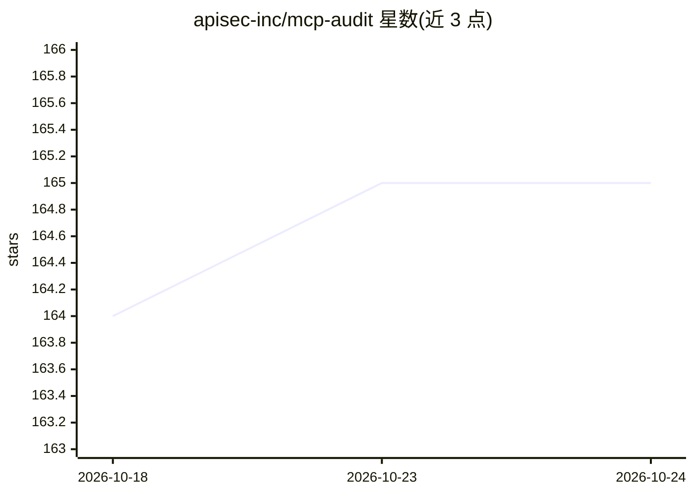

# apisec-inc/mcp-audit

⭐ 165 · Python · MIT · 推送 2026-08-18 · [GitHub](https://github.com/apisec-inc/mcp-audit) · [官网](https://apisec-inc.github.io/mcp-audit) · 组织维护

**扫描 AI 开发工具 MCP 配置的安全审计 CLI**

面向开发与安全团队的 MCP 配置审计工具：扫描 Claude Desktop、Cursor、VS Code、Windsurf、Zed 及 GitHub 仓库中的 MCP 配置，检出暴露密钥（25+ 模式）、API 端点清单、已配置的 AI 模型与风险标志（shell 访问、文件系统访问等），并映射 OWASP LLM Top 10（2025）。v1.1 新增 source-scan，读取 MCP 服务器源码检测将 LLM 控制的工具参数传入 shell 执行 API 的注入链。支持 JSON/CSV/SARIF/CycloneDX 1.6 AI-BOM 导出与 CI 门禁。提供浏览器端 Web App 与 100% 本地运行的 CLI（Python 3.9+，pip/Docker 安装）。限制：不扫描运行时环境变量、secrets manager 与动态生成的配置。

## 筛选速览

| 维度 | 判定 | 备注 |
|---|---|---|
| AI 角色 | `ai-ecosystem` | LLM/agent 周边工具 |
| 许可风险 | `permissive` | MIT |
| 部署形态 | `self-host` | docker 或自建部署 |
| 模型依赖 | — | README 未给出锁定关系 |
| 硬件要求 | — | 无带数字的原话,不猜 |
| 安装摩擦 | `low` | 无编译、无系统依赖或容器化 |
| 成熟度 | — | 结构信号不足 |

## 能力要点

- 扫描 5 种 AI 开发工具与 GitHub 仓库的 MCP 配置，检出密钥/API/模型
- source-scan 检测 MCP 服务器源码中的 shell 注入攻击链
- CycloneDX 1.6 AI-BOM 导出与 OWASP LLM Top 10 映射
- SARIF 输出与 CI/CD 合并门禁

## 适用场景

- 上线前检查本机或仓库中 AI agent 可访问的密钥与 API
- 为供应链合规生成 AI-BOM 报告
- 审计自研 MCP 服务器源码中的 shell 注入漏洞

## 场景标签

`网络安全` · 领域:学习与行业

## 证据(README 行号)

> L26: MCP Audit scans your AI development tools (Claude Desktop, Cursor, VS Code) and reveals:
> L140: |**OWASP LLM Top 10**|Maps findings to OWASP LLM Top 10 (2025) framework|
> L141: |**AI-BOM Export**|CycloneDX 1.6 for supply chain compliance|

## 星数曲线

2026-10-18 164 → 2026-10-24 165（+1）

---
*卡片 v1 · prompt 1.4 · 生成 2026-10-22 · 置信度 high · 依据 README sha `df49e81d4a12` · [字段定义](../../DATASET.md)*
