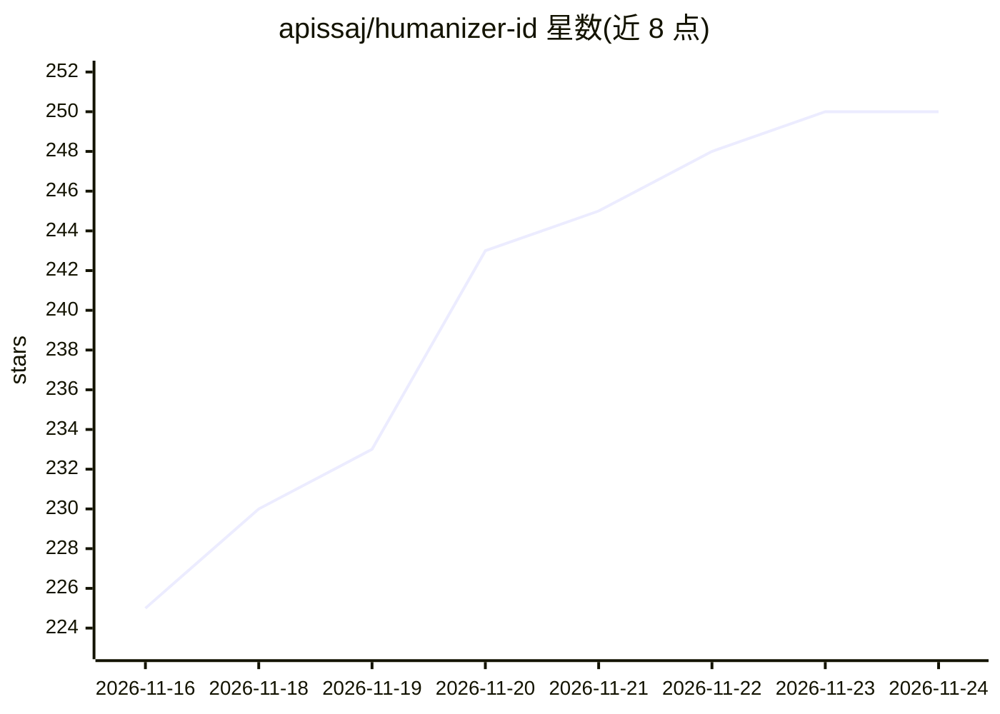

# apissaj/humanizer-id

⭐ 250 · Python · MIT · 推送 2026-11-20 · [GitHub](https://github.com/apissaj/humanizer-id) · 个人维护

**供 AI 代理使用的印尼语学术写作编辑规则库与审计 CLI**

面向 AI agent 的印尼语学术/专业文稿编辑指南：以 SKILL.md 主文档加五个按需加载的子规则包组织 599 条规范性规则，清除机翻腔、堆叠名词化、轻动词与 LLM 特有输出模式；规则均溯源至官方文档并标注页码。另附零依赖（纯标准库）的确定性审计 CLI，输出带优先级编号的发现清单；声明科学诚信约束（零数据编造、非 AI 检测器规避工具）。提供 pip 包、npx 技能安装器与网页端自定义指令三种接入方式，并内置 16 所印尼高校的论文格式预设。

## 筛选速览

| 维度 | 判定 | 备注 |
|---|---|---|
| AI 角色 | `ai-knowledge` | 知识聚合/清单类 |
| 许可风险 | `permissive` | MIT |
| 部署形态 | `library` | 以包/库形式分发 |
| 模型依赖 | — | README 未给出锁定关系 |
| 硬件要求 | — | 无带数字的原话,不猜 |
| 安装摩擦 | `low` | 无编译、无系统依赖或容器化 |
| 成熟度 | — | 结构信号不足 |

## 能力要点

- 599 条规则全部溯源官方文档并标注页码
- SKILL.md 主文档 + 5 个按需加载子规则包的技能架构
- 纯 Python 标准库的确定性审计 CLI（HIGH/MEDIUM/LOW 优先级）
- 16 所印尼高校 + 2 份期刊的格式预设与 137 条跨领域术语对照

## 适用场景

- 让 Claude Code 等 coding agent 按规范编辑我的印尼语论文
- 投稿 SINTA/Scopus 期刊前审计文稿中的 AI 腔与不合规范表达
- 按所在高校的论文格式预设（如 UI/ITB/UGM）整理稿件
- 无 coding agent 时将 PROMPT.md 用于 ChatGPT/Claude 网页端

## 场景标签

`AI 写作` `提示工程` · 领域:Agent 开发

## 证据(README 行号)

> L17: **Humanizer ID** adalah buku aturan yang dibaca agen AI setiap sesi penyuntingan naskah Indonesia. Ia membersihkan 
> L48: |**`SKILL.md`** (induk)|Aturan integritas ilmiah, pengecualian dokumen, 4 mode eksekusi, eliminasi penyakit AI leks
> L56: Arsip provenance sesi bedah tersimpan di references/log-integrasi-kaidah.md (bukan aturan operasional). Setiap entr

## 星数曲线

2026-11-16 225 → 2026-11-24 250（+25）

---
*卡片 v1 · prompt 1.4 · 生成 2026-11-17 · 置信度 high · 依据 README sha `0c942d12afc5` · [字段定义](../../DATASET.md)*
