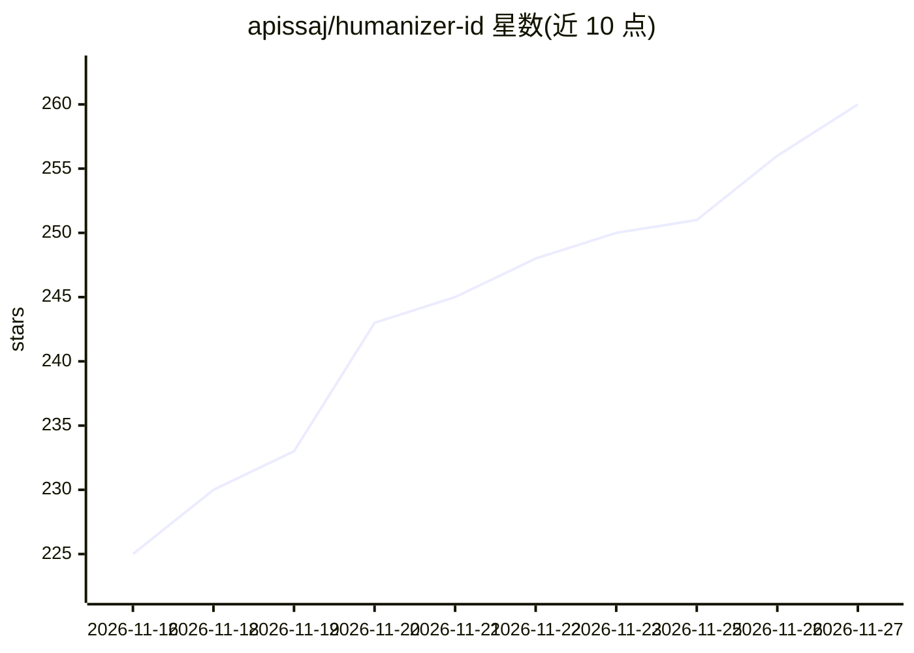

# apissaj/humanizer-id

⭐ 260 · Python · MIT · 推送 2026-11-25 · [GitHub](https://github.com/apissaj/humanizer-id) · 个人维护

**面向 AI 代理的印尼语学术文本编辑规则集与审计 CLI**

以 SKILL.md 形式提供给 AI 代理读取的印尼语学术/专业文本编辑规则书：主规则加载后按需加载 14 个子规则集，共 790 条带出处的规范性条目，用于清理翻译腔、名词化堆叠、轻动词、AI 常见文本模式等。规则源自印尼官方语言教材与词典并标注页码，含 Delivery Gate 报告机制；另附无外部依赖的确定性审计 CLI 与 JSON 数据集。声明不用于绕过 AI 检测。安装方式包括 PyPI 包、skills.sh、代理安装器与手动复制。

## 筛选速览

| 维度 | 判定 | 备注 |
|---|---|---|
| AI 角色 | `ai-knowledge` | 知识聚合/清单类 |
| 许可风险 | `permissive` | MIT |
| 部署形态 | `library` | 以包/库形式分发 |
| 模型依赖 | — | README 未给出锁定关系 |
| 硬件要求 | — | 无带数字的原话,不猜 |
| 安装摩擦 | `low` | 无编译、无系统依赖或容器化 |
| 成熟度 | — | 结构信号不足 |

## 能力要点

- 790 条规则均标注官方文档出处与页码，按需分层加载节省上下文
- 确定性审计 CLI（纯 Python 标准库），输出带 HIGH/MEDIUM/LOW 优先级的编号发现清单
- 支持 During/After 两种工作模式与 Patch-Only 省 token 输出模式
- 内置 18 个高校论文格式 preset 与开放 JSON 数据集

## 适用场景

- 让我写印尼语论文初稿后按学校 preset 清理 AI 痕迹
- 对已有印尼语文本做编号审计并选择性执行修改
- 把规则集安装进 Claude Code 等 AI 编码代理持续使用

## 场景标签

`提示工程` `AI 写作` · 领域:Agent 开发

## 证据(README 行号)

> L5: **Panduan penyuntingan bahasa Indonesia akademik & profesional untuk agen AI**
> L17: **Humanizer ID** adalah buku aturan yang dibaca agen AI setiap sesi penyuntingan naskah Indonesia. Ia membersihkan 
> L42: ## Arsitektur Skill

## 星数曲线

2026-11-16 225 → 2026-11-27 260（+35）

---
*卡片 v1 · prompt 1.4 · 生成 2026-11-25 · 置信度 high · 依据 README sha `ec336a872679` · [字段定义](../../DATASET.md)*
