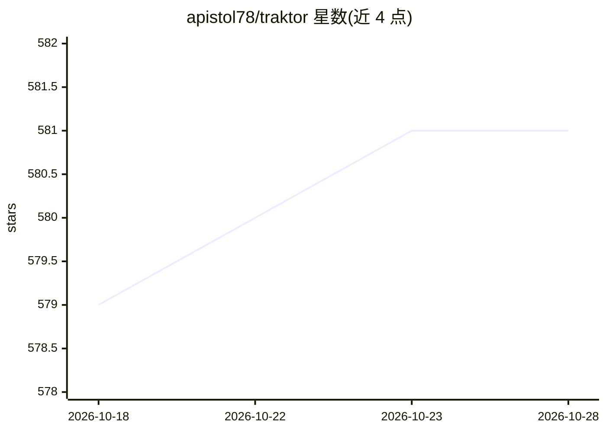

# apistol78/traktor

⭐ 581 · C++ · MPL-2.0 · 推送 2026-10-27 · [GitHub](https://github.com/apistol78/traktor) · 个人维护

**C++ 开源 3D 游戏引擎，内置编辑器与 MCP 服务器接入 AI**

用 C++ 编写的开源 3D 游戏引擎，已用于多个商业作品（Steam/PSN/iOS/Mac Store）。功能覆盖编辑器（一键部署、热重载、资产烘焙管线）、基于 Vulkan 的帧图渲染器（延迟与 Forward+ 路径、硬件光追、ReStIR 全局光照）、骨骼动画、LUA 脚本、多声道音频与 Jolt/Bullet 物理。编辑器内置 MCP 服务器供 AI 集成，可创建、查询和更新项目数据库中的资产。Windows/Linux 完整支持，提供预编译安装包，也可从源码构建。

## 筛选速览

| 维度 | 判定 | 备注 |
|---|---|---|
| AI 角色 | `ai-enhanced` | 去掉 AI 部分产品仍成立 |
| 许可风险 | `permissive` | MPL-2.0 |
| 部署形态 | `desktop` | 安装包/桌面程序 |
| 模型依赖 | — | README 未给出锁定关系 |
| 硬件要求 | — | 无带数字的原话,不猜 |
| 安装摩擦 | `low` | 无编译、无系统依赖或容器化 |
| 成熟度 | — | 结构信号不足 |

## 能力要点

- 编辑器优先，支持一键部署、跨平台热重载与资产烘焙管线
- 内置 MCP 服务器，AI 可创建/查询/更新 shader 图、实体、场景等资产
- Vulkan 帧图渲染器，支持硬件光追（RTGI/RTAO/反射/阴影）与 ReStIR GI
- 集成 Jolt 与 Bullet 物理，LUA 为主脚本语言

## 适用场景

- 开发并跨平台部署 3D 商业游戏
- 通过 MCP 协议让 AI agent 操作引擎资产
- 快速迭代关卡与着色器（热重载、即时重编译）

## 场景标签

 · 领域:游戏开发/图形

## 证据(README 行号)

> L6: Traktor is an open-source 3d game engine written in C++, it has powered several successful commercial titles across 
> L52: - Built in MCP server for AI integration. Able to create, query and update all assets (shader graphs, entities, sce

## 星数曲线

2026-10-18 579 → 2026-10-28 581（+2）

---
*卡片 v1 · prompt 1.4 · 生成 2026-10-21 · 置信度 high · 依据 README sha `ddc806c5d3b9` · [字段定义](../../DATASET.md)*
