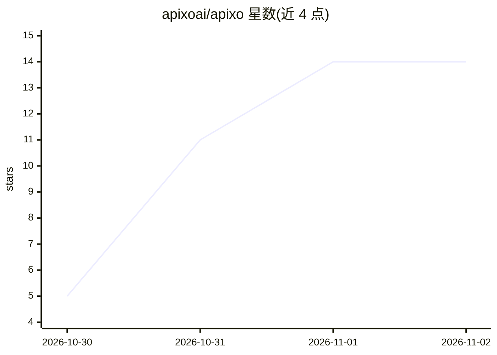

# apixoai/apixo

⭐ 14 · NOASSERTION · 推送 2026-10-28 · [GitHub](https://github.com/apixoai/apixo) · [官网](https://apixoai.online) · 组织维护

**商业 API 聚合服务：一个密钥调用无审查模型及主流闭源模型**

Apixo 是按 token 计费的模型 API 聚合服务，本仓库仅存放其文档与配置示例。单一 API key 可调用 44+ 模型，含 12 个 uncensored/abliterated 开源模型变体（GLM-5.3、DeepSeek V4、Qwen3、Gemma）及 Claude、GPT、Kimi、Gemini、Grok 等，同时提供 OpenAI 与 Anthropic 两种兼容接口（/v1/chat/completions、/v1/responses、/v1/messages）。支持流式、工具调用、缓存计价、加密货币充值与免费试用额度；附 Claude Code、Cline、Cursor 等工具的接入指南。

## 筛选速览

| 维度 | 判定 | 备注 |
|---|---|---|
| AI 角色 | `ai-ecosystem` | LLM/agent 周边工具 |
| 许可风险 | `none` | NOASSERTION |
| 部署形态 | `None` |  |
| 模型依赖 | — | README 未给出锁定关系 |
| 硬件要求 | — | 无带数字的原话,不猜 |
| 安装摩擦 | `low` | 无编译、无系统依赖或容器化 |
| 成熟度 | — | 结构信号不足 |

## 能力要点

- 单一 API key 调用 44+ 模型，切换模型仅需改模型 ID
- 同时兼容 OpenAI 与 Anthropic 两种 API 格式
- 12 个 uncensored/abliterated 模型变体（GLM-5.3、DeepSeek V4、Qwen3 等）
- 按 token 计费、加密货币充值、缓存 token 低价计费

## 适用场景

- 在 Claude Code、Cline、Cursor 等编码工具中切换使用无审查模型
- 用现有 OpenAI/Anthropic SDK 无改造接入多模型
- 按量付费调用多家模型并查看用量仪表盘

## 场景标签

`模型网关` · 领域:Agent 开发

## 证据(README 行号)

> L5: 🔓 Uncensored / abliterated GLM-5.3 · DeepSeek V4 · Qwen3 · Gemma — plus Claude · GPT · Kimi · Gemini · Grok — throug
> L35: - 🔌 **Works with your tools** — Claude Code, OpenCode, Cline, Roo Code, Kilo Code, Cursor, Continue, Codex CLI, the
> L85:  This repository contains documentation and examples only. It is not the source code of the service. ⭐ Star it to g

## 星数曲线

2026-10-30 5 → 2026-11-02 14（+9）

---
*卡片 v1 · prompt 1.4 · 生成 2026-10-31 · 置信度 high · 依据 README sha `80992bd3f268` · [字段定义](../../DATASET.md)*
