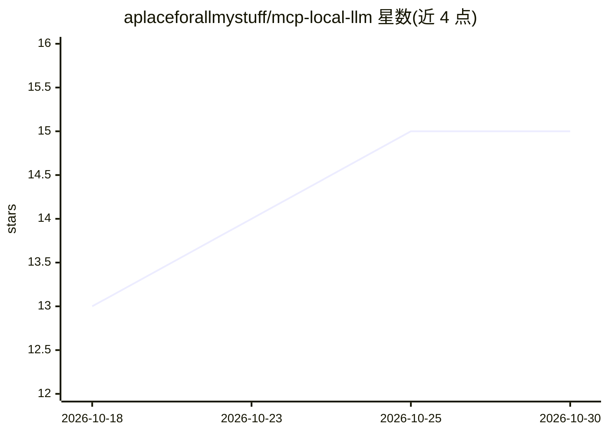

# aplaceforallmystuff/mcp-local-llm

⭐ 15 · TypeScript · MIT · 推送 2026-09-22 · [GitHub](https://github.com/aplaceforallmystuff/mcp-local-llm) · 个人维护

**让 Claude Code 把机械性任务委托给本地 LLM 的 MCP server**

TypeScript 实现的 MCP server，供 Claude Code（或其他 MCP 客户端）将摘要、分类、抽取、起草、改写等机械性任务转发给经 Ollama 本地运行的模型，也支持 Docker Model Runner 及任何 OpenAI 兼容后端。提供 local_summarize/local_draft/local_classify/local_extract/local_transform/local_complete/local_status 七个工具，模型、端口、温度等经环境变量配置。需 Ollama 与 Node.js 18+，源码 clone 后 npm 安装构建，MIT 许可。

## 筛选速览

| 维度 | 判定 | 备注 |
|---|---|---|
| AI 角色 | `ai-ecosystem` | LLM/agent 周边工具 |
| 许可风险 | `permissive` | MIT |
| 部署形态 | `library` | 以包/库形式分发 |
| 模型依赖 | local-ok | 支持本地模型 |
| 硬件要求 | — | 无带数字的原话,不猜 |
| 安装摩擦 | `low` | 无编译、无系统依赖或容器化 |
| 成熟度 | — | 结构信号不足 |

## 能力要点

- 7 个 MCP 工具覆盖摘要/分类/抽取/起草/改写/原始补全
- 默认对接 Ollama，兼容任意 OpenAI 兼容后端（含 Docker Model Runner）
- 通过 CLAUDE.md 路由指令或自定义 agent 定义控制委托行为
- 环境变量配置模型与端点，无需改代码

## 适用场景

- 批量摘要研究文件并汇总成一份文档
- 让 Claude 把收件箱笔记分类后归档到对应文件夹
- 先由本地模型生成初稿再由 Claude 审校，降低 API 成本

## 场景标签

`AI 写作` · 领域:内容生成

## 证据(README 行号)

> L3: MCP server that lets Claude Code delegate mechanical tasks to a local LLM. Claude does the thinking; your local mode
> L11: Claude Code sits at the top as the orchestrator. It calls mcp-local-llm tools via MCP, which forward requests to Ol
> L42: claude mcp add local-llm -s user -- node /path/to/mcp-local-llm/dist/index.js

## 星数曲线

2026-10-18 13 → 2026-10-30 15（+2）

---
*卡片 v1 · prompt 1.4 · 生成 2026-10-30 · 置信度 high · 依据 README sha `5b25bdea8478` · [字段定义](../../DATASET.md)*
