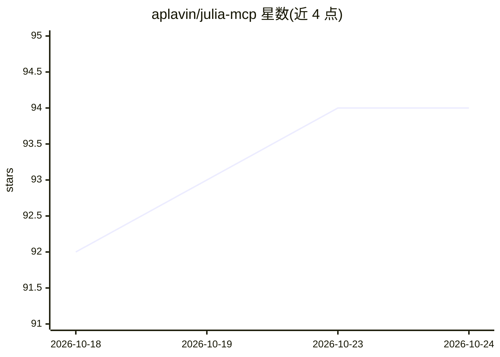

# aplavin/julia-mcp

⭐ 94 · Python · MIT · 推送 2026-08-22 · [GitHub](https://github.com/aplavin/julia-mcp) · 个人维护

**MCP server：为 AI 助手提供持久会话的 Julia 代码执行**

MCP 服务器，通过保持 Julia 会话存活跨调用复用，避免 Julia 启动与编译开销，并在调用间持久化变量、函数与已加载包等状态。会话按需启动、崩溃自动恢复，每个项目目录对应独立隔离的 Julia 进程，使用纯 stdio 传输、不开放端口。提供 julia_eval/julia_restart/julia_list_sessions 三个工具；服务器本体用 Python 编写，需 uv 与 PATH 中的 Julia。附 Claude Code、Claude Desktop、Codex CLI、VS Code Copilot 等客户端的注册说明，README 列出 MCPRepl.jl、DaemonConductor.jl 等同类项目。

## 筛选速览

| 维度 | 判定 | 备注 |
|---|---|---|
| AI 角色 | `ai-ecosystem` | LLM/agent 周边工具 |
| 许可风险 | `permissive` | MIT |
| 部署形态 | `None` |  |
| 模型依赖 | locked-api |  |
| 硬件要求 | — | 无带数字的原话,不猜 |
| 安装摩擦 | `low` | 无编译、无系统依赖或容器化 |
| 成熟度 | — | 结构信号不足 |

## 能力要点

- 持久 Julia 会话，跨调用保留变量/函数/包加载状态并从崩溃恢复
- 每个 env_path 独立隔离的 Julia 进程，纯 stdio 传输无开放端口
- julia_eval 支持 env_path/timeout 参数，Pkg 操作自动禁用超时
- 可选自动利用 Revise.jl（免重启拾取改动）与 TestEnv.jl（自动激活测试环境）

## 适用场景

- 让 Claude Code 或 Copilot 等 AI 助手高效执行 Julia 代码迭代
- 在 AI 辅助的 Julia 项目开发中避免每次调用的启动/编译等待
- 跨多次对话调用保持 Julia 工作区状态

## 场景标签

 · 领域:AI 开发者工具/Julia

## 证据(README 行号)

> L3: MCP server that gives AI assistants access to efficient Julia code execution. Avoids Julia's startup and compilation
> L11: - **julia_eval(code, env_path?, timeout?)** — execute Julia code in a persistent session. `env_path` sets the Julia

## 星数曲线

2026-10-18 92 → 2026-10-24 94（+2）

---
*卡片 v1 · prompt 1.4 · 生成 2026-10-23 · 置信度 high · 依据 README sha `91572117a3e7` · [字段定义](../../DATASET.md)*
