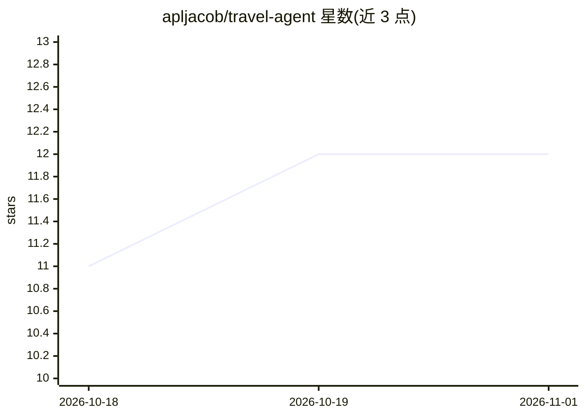

# apljacob/travel-agent

⭐ 12 · NOASSERTION · 推送 2026-05-05 · [GitHub](https://github.com/apljacob/travel-agent) · [官网](https://github.com/apljacob/travel-agent) · 个人维护

**把 Claude 变成旅行规划师的 Claude Code 技能**

一个 Claude Code 技能（SKILL.md 及配套模板）：在用户提出旅行规划类请求时触发 7 阶段工作流——批量发现提问、目的地三选项对比、实时 web 搜索的物流要点、逐日行程（含主备方案）、预订截止日期追踪、行装准备，最终本地生成 PDF 交付物。内置 13 条源自专业旅行策划方法论的规则，并对不合理行程做出反驳建议。通过 claude plugin 命令安装；CC BY-NC 4.0 非商业许可，不做实际预订。

## 筛选速览

| 维度 | 判定 | 备注 |
|---|---|---|
| AI 角色 | `ai-native` | 本体是模型或模型工具 |
| 许可风险 | `none` | NOASSERTION |
| 部署形态 | `None` |  |
| 模型依赖 | — | README 未给出锁定关系 |
| 硬件要求 | — | 无带数字的原话,不猜 |
| 安装摩擦 | `low` | 无编译、无系统依赖或容器化 |
| 成熟度 | — | 结构信号不足 |

## 能力要点

- 7 阶段旅行规划工作流，触发词软匹配
- 每个具体结论前进行实时 web 搜索（价格/营业时间/签证）
- 逐日行程含命名主景点与备选，并对坏主意给出反驳与替代
- 生成含封面、预订追踪、行装清单的本地 PDF

## 适用场景

- 让 Claude Code 帮我做从目的地选择到逐日行程的完整旅行规划
- 提醒我各类预订的截止日期并追踪状态
- 生成一份可带走的 PDF 行程手册

## 场景标签

 · 领域:旅行规划/AI 技能

## 证据(README 行号)

> L3: A Claude Code skill that turns Claude into a world-class travel planner.
> L18: The skill fires on a soft match. It then runs a 7-phase workflow:
> L31: claude plugin marketplace add apljacob/travel-agent

## 星数曲线

2026-10-18 11 → 2026-11-01 12（+1）

---
*卡片 v1 · prompt 1.4 · 生成 2026-11-01 · 置信度 high · 依据 README sha `a71c7ed7f068` · [字段定义](../../DATASET.md)*
