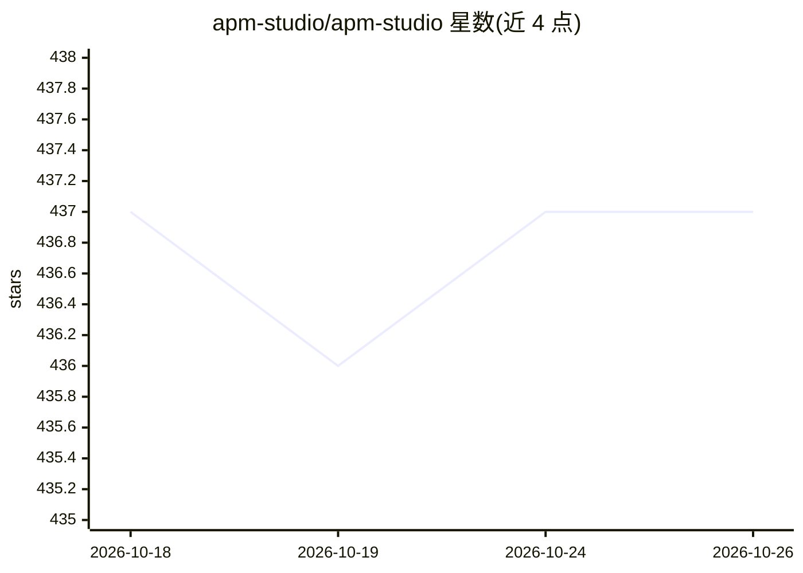

# apm-studio/apm-studio

⭐ 437 · TypeScript · MIT · 推送 2026-06-03 · [GitHub](https://github.com/apm-studio/apm-studio) · [官网](https://discord.gg/amEHpsqwZP) · 组织维护

**本地 GUI：导入、管理与同步 APM agent 包到各编码助手**

Agent Package Manager（APM）生态的可视化层：从 GitHub 导入 agents、skills、prompts、hooks 与 MCP 配置，在本地 packages/<packageId>/ 管理包元数据，用 OpenCode 作为本地 Studio Agent 运行时测试，再通过 Export 将所选 APM 原语同步到 Codex、Claude、Cursor、Gemini、OpenCode 等助手的目标文件。包校验与广泛目标安装委托给上游 Microsoft APM CLI，无 CLI 时仅回退到有限的 agent/skill 同步。以 npm 包 apm-studio 提供，含安装脚本与 CLI。

## 筛选速览

| 维度 | 判定 | 备注 |
|---|---|---|
| AI 角色 | `ai-ecosystem` | LLM/agent 周边工具 |
| 许可风险 | `permissive` | MIT |
| 部署形态 | `library` | 以包/库形式分发 |
| 模型依赖 | — | README 未给出锁定关系 |
| 硬件要求 | — | 无带数字的原话,不猜 |
| 安装摩擦 | `low` | 无编译、无系统依赖或容器化 |
| 成熟度 | — | 结构信号不足 |

## 能力要点

- Import/Manage/Run/Export 四步流程，源与输出分离
- 同步 APM agents、skills、prompts、hooks、MCP 配置到多种助手目标
- OpenCode 本地 Studio Agent 运行时与 Studio 专属模型设置
- 包校验与目标安装委托 Microsoft APM CLI（CLI-first 回退链）

## 适用场景

- 从 GitHub 导入 APM 包并在本地管理 agent/skill 组合
- 把选定的 agent、prompt、MCP 配置同步到我在用的编码助手
- 在本地测试 Studio Agent 后再导出到助手目标文件

## 场景标签

`提示工程` · 领域:Agent 开发

## 证据(README 行号)

> L5: **A local GUI for Agent Package Manager packages: import agents, skills, prompts, hooks, and MCP configs, then sync 
> L15: APM Studio is the visual layer for the APM ecosystem. It imports source references from GitHub, manages local packa
> L86: APM Studio keeps package authoring, local Studio Agent runs, and assistant target sync in one UI while delegating p

## 星数曲线

2026-10-18 437 → 2026-10-26 437（+0）

---
*卡片 v1 · prompt 1.4 · 生成 2026-10-21 · 置信度 high · 依据 README sha `75b5f5194249` · [字段定义](../../DATASET.md)*
