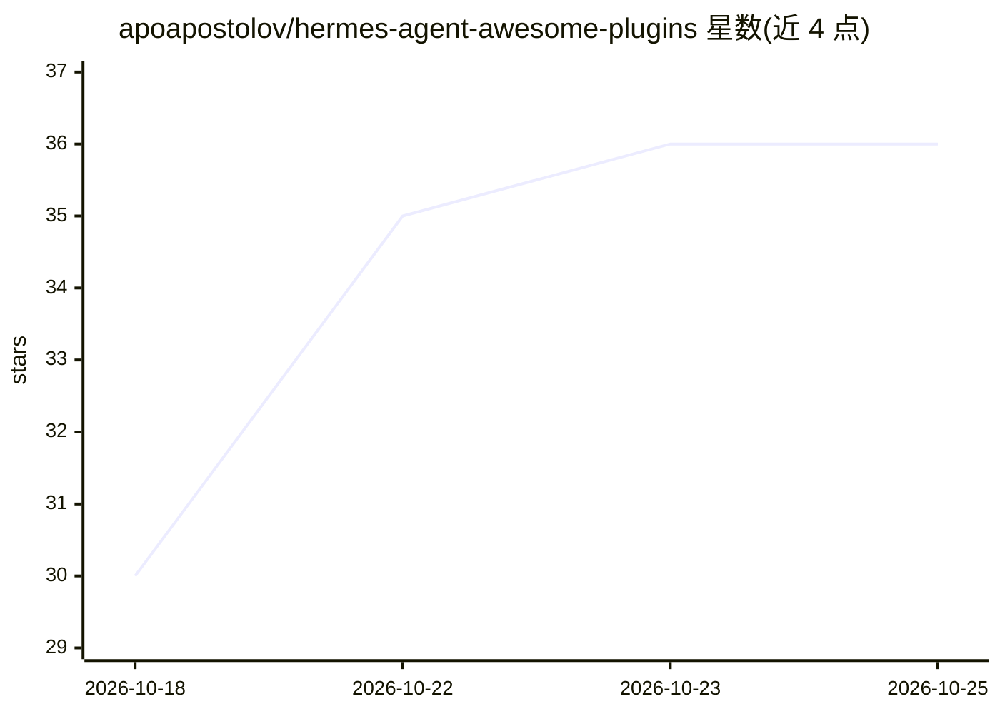

# apoapostolov/hermes-agent-awesome-plugins

⭐ 36 · JavaScript · MIT · 推送 2026-10-23 · [GitHub](https://github.com/apoapostolov/hermes-agent-awesome-plugins) · 个人维护

**Hermesis Agent 桌面端插件包：配额监控、会话管理、记忆审核、RSS 阅读**

面向 Hermes Agent（Nous Research）桌面端与 CLI 的 16 个 JavaScript 插件包：provider-status 在状态栏显示多家 provider 的配额余量与多账号轮换，另有迭代预算表、卡住工具的 /break 控制、记忆写入的对话框审核、会话外观/置顶/重命名/滚动控制、CDP 端口管理、提示词改写与三栏 RSS 阅读器。安装通过 hermes plugins pack install 拉取 hermes-pack.yaml，每个条目以 repo+subdir+40 位 commit SHA 固定。个人版可触及桌面端内部（DOM、持久化密钥），公共版限于插件 SDK 面；需要 Hermes Agent 0.21.0 或更新版本。

## 筛选速览

| 维度 | 判定 | 备注 |
|---|---|---|
| AI 角色 | `ai-ecosystem` | LLM/agent 周边工具 |
| 许可风险 | `permissive` | MIT |
| 部署形态 | `None` |  |
| 模型依赖 | — | README 未给出锁定关系 |
| 硬件要求 | — | 无带数字的原话,不猜 |
| 安装摩擦 | `low` | 无编译、无系统依赖或容器化 |
| 成熟度 | — | 结构信号不足 |

## 能力要点

- 13 个插件由 hermes-pack.yaml 按 40 位 commit SHA 固定，安装结果与 main 分支尖端无关
- provider-status 支持约 18 家 provider 的配额显示、多账号轮换与 Grok/Codex OAuth
- 每个插件独立能力授权，插件包不做批量授权，密钥保持 requires_env 不内嵌
- personal/public 双树结构，公共版限定在插件 SDK 契约内

## 适用场景

- 在 Hermes 桌面端状态栏跟踪多家模型 provider 的配额与轮换账号
- 长会话中控制卡住的工具调用并设置迭代预算
- 审核 AI agent 的记忆写入，按需批准或拒绝
- 在 agent 界面内直接阅读 RSS 订阅源

## 场景标签

 · 领域:AI agent 桌面工具/插件

## 证据(README 行号)

> L9:  Type: Plugin pack
> L34: hermes plugins install apoapostolov/hermes-agent-awesome-plugins/personal/<id>
> L94: Requires Hermes Agent **0.21.0 or newer**.

## 星数曲线

2026-10-18 30 → 2026-10-25 36（+6）

---
*卡片 v1 · prompt 1.4 · 生成 2026-10-25 · 置信度 high · 依据 README sha `129af5fb2b90` · [字段定义](../../DATASET.md)*
