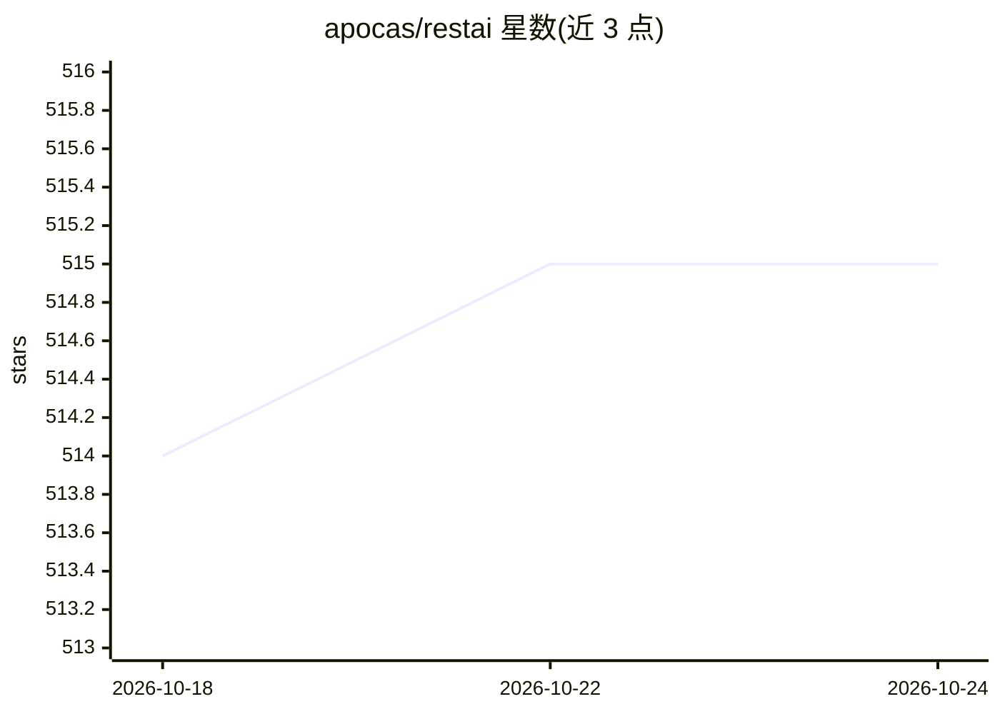

# apocas/restai

⭐ 515 · Python · Apache-2.0 · 推送 2026-10-24 · [GitHub](https://github.com/apocas/restai) · [官网](https://restai.cloud) · 个人维护

**开源 AIaaS 平台：创建 AI 项目并通过 REST API 与 Web 界面使用**

基于 FastAPI 的多项目 AI 服务平台：每个项目可配置独立 LLM、系统提示词与工具，通过 REST API 和 React 仪表盘访问。功能覆盖 RAG（多向量库、重排序、SQL-to-NL）、知识图谱、ReAct Agent 与 MCP 工具接入、Agentic 浏览器（Playwright 容器）、多模态推理、Blockly 可视化逻辑、图像生成、零样本文本分类、评测与提示词版本管理、团队多租户与 RBAC。支持 OpenAI/Anthropic/Ollama/vLLM 等多种 LLM 后端，并提供 OpenAI 兼容端点。安装途径含 PyPI、源码与 Docker 镜像。

## 筛选速览

| 维度 | 判定 | 备注 |
|---|---|---|
| AI 角色 | `ai-ecosystem` | LLM/agent 周边工具 |
| 许可风险 | `permissive` | Apache-2.0 |
| 部署形态 | `self-host` | docker 或自建部署 |
| 模型依赖 | local-ok | 支持本地模型 |
| 硬件要求 | — | 无带数字的原话,不猜 |
| 安装摩擦 | `low` | 无编译、无系统依赖或容器化 |
| 成熟度 | — | 结构信号不足 |

## 能力要点

- RAG 项目支持多向量库、重排序、SQL-to-NL 与 DeepEval 评测
- Agent 支持 MCP 工具接入与容器化 Agentic 浏览器（九个 browser_* 工具、加密凭据库、域名白名单）
- OpenAI 兼容 API（chat/completions、images、audio transcriptions）
- 团队多租户、RBAC、OAuth/LDAP、TOTP 2FA 与白标定制
- 内置 Blockly 可视化逻辑构建器与零样本文本分类 Playground

## 适用场景

- 搭建团队内共享的多项目 LLM 服务并通过 REST API 调用
- 部署带权限管控与用量分析的私有 RAG 知识库问答
- 用现有 OpenAI SDK 接入自托管的 LLM/图像/转录服务

## 场景标签

`RAG` `Agent 框架` `浏览器自动化` · 领域:Agent 开发

## 证据(README 行号)

> L4:  AIaaS (AI as a Service) — Create AI projects and consume them via a simple REST API.
> L83: - **Any LLM** — OpenAI, Anthropic, Ollama, Gemini, LiteLLM, vLLM, Azure, and more

## 星数曲线

2026-10-18 514 → 2026-10-24 515（+1）

---
*卡片 v1 · prompt 1.4 · 生成 2026-10-21 · 置信度 high · 依据 README sha `4d80c7783b7f` · [字段定义](../../DATASET.md)*
