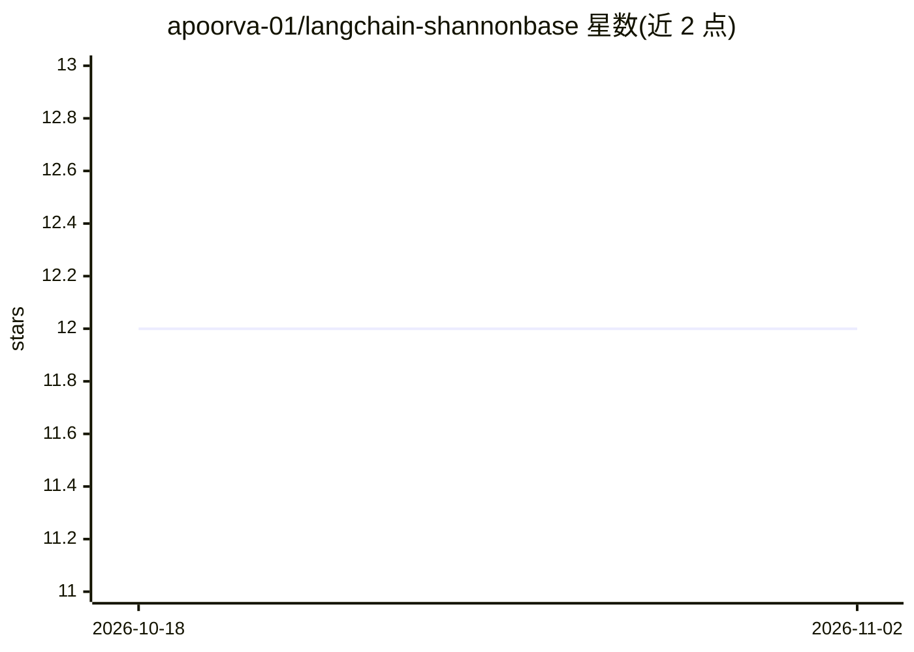

# apoorva-01/langchain-shannonbase

⭐ 12 · Python · MIT · 推送 2026-07-18 · [GitHub](https://github.com/apoorva-01/langchain-shannonbase) · 个人维护

**基于 MySQL 9 原生 VECTOR 类型的 LangChain VectorStore，实现 MySQL 内 RAG**

为 LangChain 提供以 MySQL 9 原生 VECTOR 类型为后端的向量存储，支持 ShannonBase、自托管 MySQL 9 与 HeatWave 三种后端，数据已在 MySQL 时无需单独向量数据库。提供相似度检索（cosine/dot/euclidean）、元数据过滤、MMR、基于倒数排名融合的向量+FULLTEXT 混合检索、异步方法与自建 k-means IVF 近似索引；HeatWave 上可直接使用其原生 HNSW 索引。通过 pip 安装，需 Python 3.9+ 与 MySQL-9 兼容数据库，MIT 许可。

## 筛选速览

| 维度 | 判定 | 备注 |
|---|---|---|
| AI 角色 | `ai-ecosystem` | LLM/agent 周边工具 |
| 许可风险 | `permissive` | MIT |
| 部署形态 | `library` | 以包/库形式分发 |
| 模型依赖 | — | README 未给出锁定关系 |
| 硬件要求 | — | 无带数字的原话,不猜 |
| 安装摩擦 | `low` | 无编译、无系统依赖或容器化 |
| 成熟度 | — | 结构信号不足 |

## 能力要点

- similarity_search / MMR / 元数据过滤等标准 VectorStore 接口
- 向量 + FULLTEXT 关键词混合检索（倒数排名融合，vector_weight 可调）
- 应用层 k-means IVF 近似索引支持大规模表；HeatWave 自动走原生 HNSW 索引
- 异步支持（aiomysql），连接池默认 5

## 适用场景

- 数据已在 MySQL、想在 LangChain 链里直接做检索而不引入独立向量库
- 在 Python 中编排自己的 embeddings 并以 MySQL 为向量后端做 RAG
- 大规模向量表上用 IVF 索引降低检索扫描量

## 场景标签

`RAG` `向量数据库` · 领域:知识与检索

## 证据(README 行号)

> L8: A LangChain `VectorStore` backed by MySQL 9's native `VECTOR` type. If your data already lives in MySQL, you can do 
> L22: It passes LangChain's standard vector-store integration suite, so it behaves like any other store you'd drop into a

## 星数曲线

2026-10-18 12 → 2026-11-02 12（+0）

---
*卡片 v1 · prompt 1.4 · 生成 2026-11-01 · 置信度 high · 依据 README sha `0f2d303a4f9a` · [字段定义](../../DATASET.md)*
