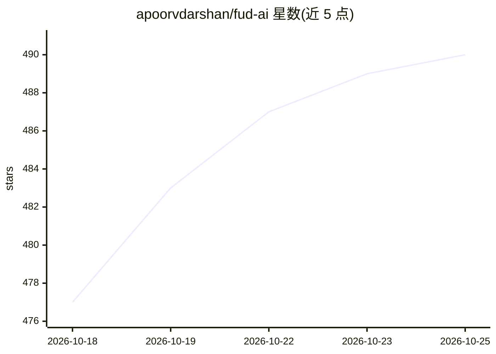

# apoorvdarshan/fud-ai

⭐ 494 · Kotlin · MIT · 推送 2026-10-24 · [GitHub](https://github.com/apoorvdarshan/fud-ai) · [官网](https://fud-ai.app) · 个人维护

**面向消费者的开源 AI 卡路里与运动追踪 App（iOS/Android）**

本地优先、隐私优先的跨平台饮食与运动记录应用：通过拍照（最多 10 张）、扫码、文字、语音或 Siri 快捷指令记录饮食，由用户自带 Key 的 AI 提供商（13 家，含 Gemini/OpenAI/Claude/Grok/Groq 及任意 OpenAI 兼容端点，iOS 另有 Apple Intelligence 端内回退）分析食物营养；带多轮对话 AI 教练、热量/体重预测、营养目标估算。支持 Apple Health/Health Connect 双向同步、锻炼记录、可选断食与饮水跟踪，无强制账户。以 App Store 与 Google Play 分发，也可从源码构建。

## 筛选速览

| 维度 | 判定 | 备注 |
|---|---|---|
| AI 角色 | `ai-native` | 本体是模型或模型工具 |
| 许可风险 | `permissive` | MIT |
| 部署形态 | `None` |  |
| 模型依赖 | locked-api |  |
| 硬件要求 | — | 无带数字的原话,不猜 |
| 安装摩擦 | `medium` | 含编译或系统依赖之一 |
| 成熟度 | — | 结构信号不足 |

## 能力要点

- BYOK 接入 13 家 AI 提供商及任意 OpenAI 兼容端点
- 多照片/扫码/语音/Siri 多种记录方式，最多 10 张照片联合分析
- 多轮对话 AI 教练，可检索体重、营养、训练等上下文
- 本地优先，无强制账户，核心数据不依赖云端同步

## 适用场景

- 拍照或语音记录三餐并自动获取卡路里与营养成分
- 向 AI 教练询问减重/增肌进度与训练表现
- 配合 Apple Health/Health Connect 同步体重与运动数据

## 场景标签

`AI 助手` `聊天机器人` · 领域:对话与助手

## 证据(README 行号)

> L24: Open-source, privacy-first calorie tracker for iOS and Android. Bring your own AI provider — 13 supported including
> L55: - **AI Coach tab** — multi-turn chat with memory. Coach can retrieve relevant profile, weight, body-fat, nutrition,

## 星数曲线

2026-10-18 477 → 2026-10-25 490（+13）

---
*卡片 v1 · prompt 1.4 · 生成 2026-10-21 · 置信度 high · 依据 README sha `f2105fbe678e` · [字段定义](../../DATASET.md)*
