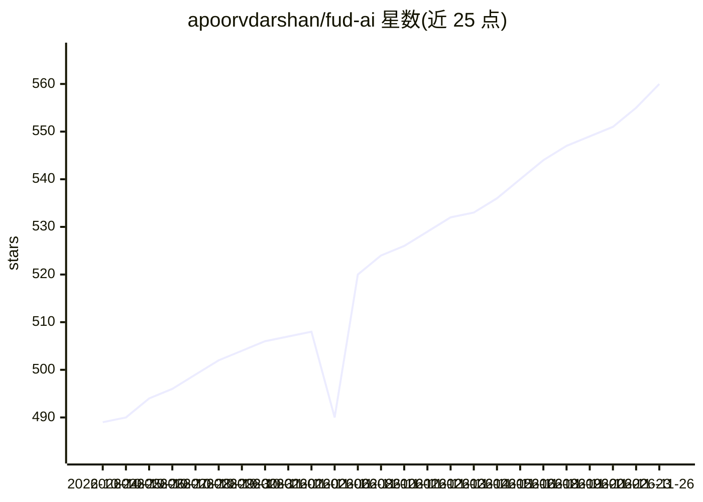

# apoorvdarshan/fud-ai

⭐ 560 · Kotlin · MIT · 推送 2026-11-25 · [GitHub](https://github.com/apoorvdarshan/fud-ai) · [官网](https://fud-ai.app) · 组织维护

**自带密钥的开源卡路里与锻炼记录应用（iOS/Android）**

开源、本地优先的卡路里与锻炼追踪应用，覆盖 iOS 与 Android。食物记录方式包括拍照（最多10张）、条码扫描、文字、语音与 Siri 捷径，由用户自选的 AI 提供方分析生成营养数据；内置多轮对话 AI Coach，可结合体重、营养与训练记录回答问题。核心功能无需账号、无广告，数据可同步 Apple Health/Health Connect，另提供断食、饮水、体重预测等模块。可选 Plus/Pro 托管 AI 通过应用商店提供。

## 筛选速览

| 维度 | 判定 | 备注 |
|---|---|---|
| AI 角色 | `ai-native` | 本体是模型或模型工具 |
| 许可风险 | `permissive` | MIT |
| 部署形态 | `None` |  |
| 模型依赖 | local-ok | 支持本地模型 |
| 硬件要求 | — | 无带数字的原话,不猜 |
| 安装摩擦 | `medium` | 含编译或系统依赖之一 |
| 成熟度 | — | 结构信号不足 |

## 能力要点

- BYOK 接入 13 家 AI 提供方及任意 OpenAI 兼容端点
- 照片/条码/语音/文字多种食物记录入口
- 多轮记忆 AI Coach 与体重预测（30/60/90 天）
- Apple Health 与 Health Connect 双向同步

## 适用场景

- 拍照记录餐食并自动生成热量与营养数据
- 结合训练和体重数据向 AI 教练咨询减重/增肌方案
- 本地优先管理断食、饮水与锻炼日志

## 场景标签

 · 领域:健康/健身

## 证据(README 行号)

> L25: Open-source, privacy-first calorie tracker for iOS and Android. Bring your own AI provider — 13 supported including
> L58: - **AI Coach tab** — multi-turn chat with memory. Coach can retrieve relevant profile, weight, body-fat, nutrition,

## 星数曲线

2026-10-24 489 → 2026-11-26 560（+71）

---
*卡片 v1 · prompt 1.4 · 生成 2026-11-25 · 置信度 high · 依据 README sha `affcbb0c8997` · [字段定义](../../DATASET.md)*
