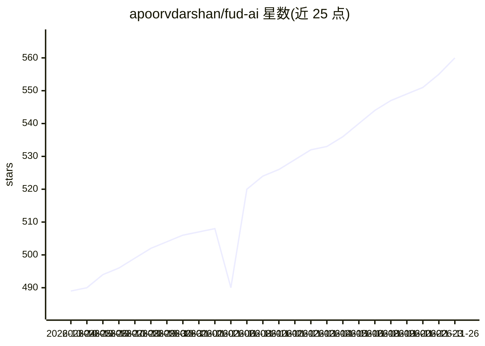

# apoorvdarshan/fud-ai

⭐ 560 · Kotlin · MIT · 推送 2026-11-25 · [GitHub](https://github.com/apoorvdarshan/fud-ai) · [官网](https://fud-ai.app) · 个人维护

**开源 AI 卡路里与训练追踪 App，iOS/Android 本地优先**

面向 iPhone/iPad 与 Android 用户的开源卡路里与营养追踪应用：通过拍照、语音、条码、文字或手动方式记录饮食，AI 生成估算后由用户确认再保存；支持宏量营养素、水分、体重、禁食与训练日志。AI 采用 Bring Your Own Key 模式，密钥与请求在设备端配置直连服务商，另有 Apple Intelligence 与可下载 Gemma 的本机选项，以及可选的 Hosted Plus/Pro 订阅。核心追踪不需账号、云同步或广告，数据经 Apple Health / Health Connect 双向同步。

## 筛选速览

| 维度 | 判定 | 备注 |
|---|---|---|
| AI 角色 | `ai-native` | 本体是模型或模型工具 |
| 许可风险 | `permissive` | MIT |
| 部署形态 | `None` |  |
| 模型依赖 | local-ok | 支持本地模型 |
| 硬件要求 | — | 无带数字的原话,不猜 |
| 安装摩擦 | `medium` | 含编译或系统依赖之一 |
| 成熟度 | — | 结构信号不足 |

## 能力要点

- 照片/语音/条码/文字多方式记录饮食，保存前人工复核 AI 估算
- BYOK 直连多家服务商，另有 Apple Intelligence 与 Gemma 本机选项
- Apple Health 与 Health Connect 双向同步（营养、体重、训练消耗）
- 877 个动作库、训练日记与卡路里消耗估算

## 适用场景

- 不用账号与云服务，本地记录每日饮食与宏量营养素
- 用自己已有的模型 API key 驱动食物照片分析与 AI 教练
- 把饮食、体重、训练数据同步到 Apple Health / Health Connect

## 场景标签

`多模态` · 领域:感知与多模态

## 证据(README 行号)

> L25: Open-source calorie and nutrition tracker for iPhone, iPad, and Android. Log food by voice, photo, barcode, text, o
> L59: - **AI Access** — free Bring Your Own Key: pick provider, model, fallback, custom instructions, and speech language
> L108: Pick a provider for food analysis, meal what-if suggestions, optional nutrient-goal estimation, and Coach chat. BY

## 星数曲线

2026-10-24 489 → 2026-11-26 560（+71）

---
*卡片 v1 · prompt 1.4 · 生成 2026-11-26 · 置信度 high · 依据 README sha `79d4a6a34ba1` · [字段定义](../../DATASET.md)*
