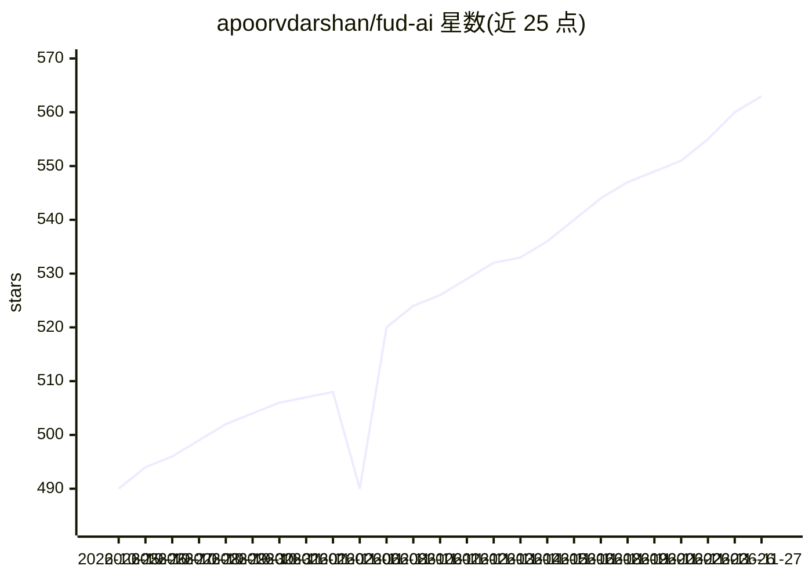

# apoorvdarshan/fud-ai

⭐ 563 · Kotlin · MIT · 推送 2026-11-26 · [GitHub](https://github.com/apoorvdarshan/fud-ai) · [官网](https://fud-ai.app) · 组织维护

**开源本地优先的 AI 卡路里与锻炼追踪 App（iOS/Android）**

面向 iPhone/iPad/Android 用户的开源卡路里与营养追踪应用：支持照片（最多 10 张合并分析）、语音、条码、文本与手动记录，保存前可人工修订估算值；跟踪宏量营养素、水、禁食与锻炼。AI 部分默认自带密钥（BYOK）直连所选服务商，可选 Apple Intelligence 端上回退；AI Coach 提供带记忆的多轮对话并检索个人档案与训练上下文。数据本地优先，无强制账户，Apple Health/Health Connect 双向同步，支持 19 种语言。

## 筛选速览

| 维度 | 判定 | 备注 |
|---|---|---|
| AI 角色 | `ai-native` | 本体是模型或模型工具 |
| 许可风险 | `permissive` | MIT |
| 部署形态 | `None` |  |
| 模型依赖 | local-ok | 支持本地模型 |
| 硬件要求 | — | 无带数字的原话,不猜 |
| 安装摩擦 | `medium` | 含编译或系统依赖之一 |
| 成熟度 | — | 结构信号不足 |

## 能力要点

- 照片/语音/条码/文本多模态记录饮食，保存前人工复核估算
- BYOK 模式：请求直接发往所配置服务商，另有端上回退选项
- AI Coach 多轮对话，可检索体重、营养、锻炼等已记录上下文
- Apple Health / Health Connect 双向同步与重装恢复

## 适用场景

- 拍下餐食由 AI 估算热量并跟踪宏量营养素
- 用自带 API 密钥在本地管理 AI 配置以追踪饮食
- 锻炼日记与 877 个动作库配合训练问答
- 跨 Apple Health / Health Connect 同步体重与营养数据

## 场景标签

`多模态` · 领域:感知与多模态

## 证据(README 行号)

> L25: Open-source calorie and nutrition tracker for iPhone, iPad, and Android. Log food by voice, photo, barcode, text, o
> L59: - **AI Access** — free Bring Your Own Key: pick provider, model, fallback, custom instructions, and speech language
> L110: |Provider|Format|Highlight|Needs API Key|

## 星数曲线

2026-10-25 490 → 2026-11-27 563（+73）

---
*卡片 v1 · prompt 1.4 · 生成 2026-11-27 · 置信度 mid · 依据 README sha `7d908c5195c1` · [字段定义](../../DATASET.md)*
