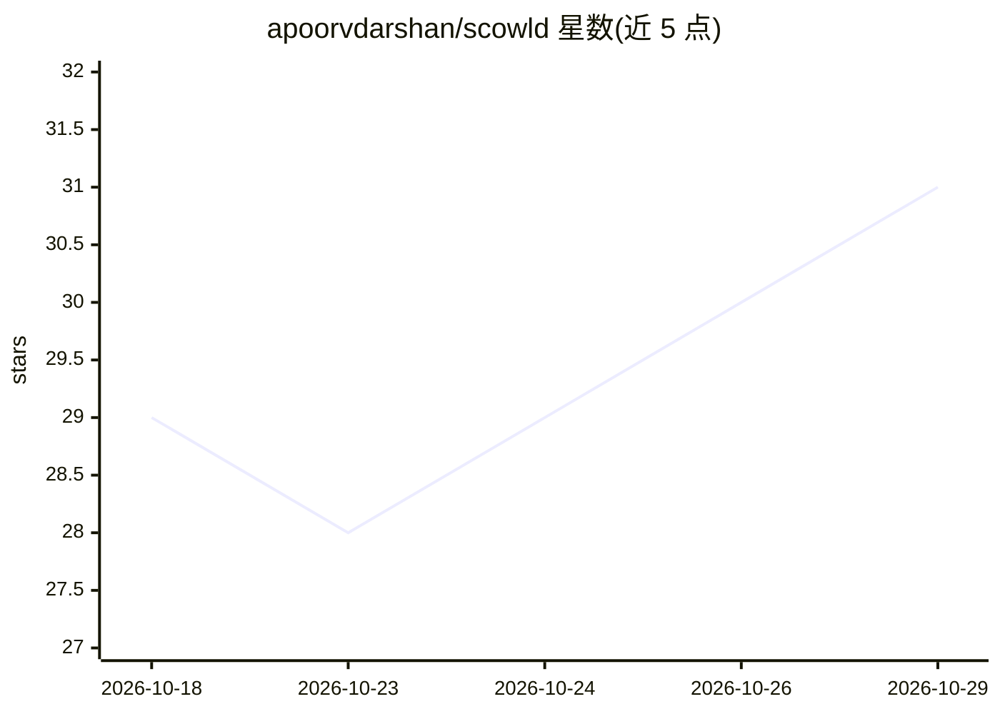

# apoorvdarshan/scowld

⭐ 31 · Swift · MIT · 推送 2026-10-26 · [GitHub](https://github.com/apoorvdarshan/scowld) · [官网](https://apps.apple.com/in/app/scowld-ai-voice-companion/id6760672848) · 个人维护

**iOS 语音 AI 伴侣应用：VRM 虚拟角色实时对话**

SwiftUI 编写的 iOS 应用，提供带 VRM 动画角色的实时语音对话：经单一实时连接接入所选择的语音服务商，支持打断（barge-in）、免唤醒词监听、可选前置摄像头视觉上下文、字幕与设备端保存对话记录。自带 API Key（Google Gemini Live、OpenAI Realtime、xAI Grok Voice）可免费无限使用，Key 存于 iOS Keychain 且不经过 Scowld 服务器；另提供可选付费的 Scowld Premium（无需 Key，经 Scowld 的 Cloudflare Worker 中继）。需 iOS 17+、Xcode 26+ 从源码构建，亦上架 App Store。

## 筛选速览

| 维度 | 判定 | 备注 |
|---|---|---|
| AI 角色 | `ai-native` | 本体是模型或模型工具 |
| 许可风险 | `permissive` | MIT |
| 部署形态 | `library` | 以包/库形式分发 |
| 模型依赖 | locked-api |  |
| 硬件要求 | — | 无带数字的原话,不猜 |
| 安装摩擦 | `low` | 无编译、无系统依赖或容器化 |
| 成熟度 | — | 结构信号不足 |

## 能力要点

- VRM 角色渲染与由实时音频驱动的口型同步
- BYOK 实时语音服务商：Gemini Live / OpenAI Realtime / xAI Grok Voice
- API Key 存于 iOS Keychain，自带 Key 模式不经过 Scowld 服务器
- 免唤醒模式使用 Apple 端上语音识别，会话开始前不发送任何内容

## 适用场景

- 在 iPhone 上与虚拟角色进行实时语音对话
- 自带 API Key 免费使用各家的实时语音模型
- 开启摄像头让角色看到并回应眼前场景

## 场景标签

`语音 Agent` `AI 助手` · 领域:对话与助手

## 证据(README 行号)

> L5:  An iOS AI voice companion with an animated character you talk to live, hands-free wake mode, bring-your-own-key liv
> L29: - **BYOK live voice providers** - Google Gemini Live, OpenAI Realtime, and xAI Grok Voice with your own API key, fr

## 星数曲线

2026-10-18 29 → 2026-10-29 31（+2）

---
*卡片 v1 · prompt 1.4 · 生成 2026-10-26 · 置信度 high · 依据 README sha `1c60c99b4087` · [字段定义](../../DATASET.md)*
