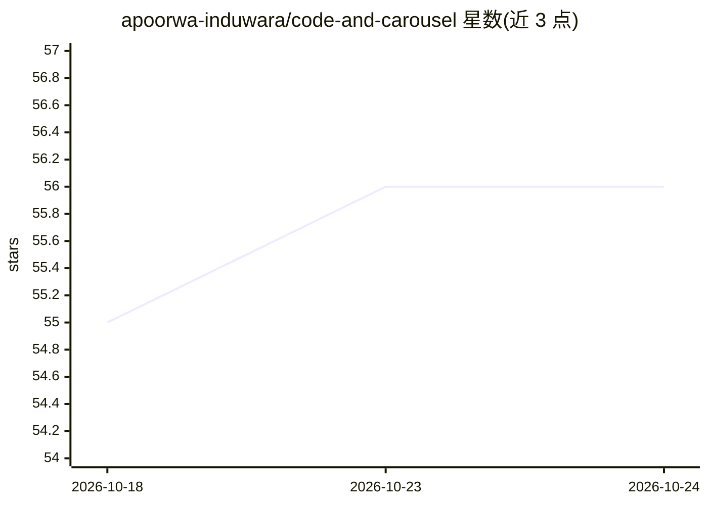

# apoorwa-induwara/code-and-carousel

⭐ 56 · HTML · 推送 2026-10-23 · [GitHub](https://github.com/apoorwa-induwara/code-and-carousel) · 个人维护

**面向 IT 从业者的实践技能学习平台，含 AI 虚拟学员陪练**

CogniForge 是一个 Web 端技能训练平台，面向 IT 从业者、自学者、技术导师与管理者。核心功能包括 ForgeLabs 混乱场景挑战沙箱（含故障注入与决策路径分析）、PraxisMaps 概念依赖图、Mentor Mirror 反向教学引擎（AI 扮演提问的虚拟初学者并给出清晰度评分）、14 种语言界面与 Workability Index 仪表盘。平台以微服务与容器化架构描述，提供 Forge API 集成入口，采用 MIT 许可证。README 未给出实际可运行的安装步骤或代码入口，无候选清单词条命中。

## 筛选速览

| 维度 | 判定 | 备注 |
|---|---|---|
| AI 角色 | `ai-enhanced` | 去掉 AI 部分产品仍成立 |
| 许可风险 | `none` | — |
| 部署形态 | `None` |  |
| 模型依赖 | — | README 未给出锁定关系 |
| 硬件要求 | — | 无带数字的原话,不猜 |
| 安装摩擦 | `low` | 无编译、无系统依赖或容器化 |
| 成熟度 | — | 结构信号不足 |

## 能力要点

- ForgeLabs 故障注入式实战沙箱与决策路径分析
- Mentor Mirror AI 虚拟初学者反向教学与清晰度评分
- PraxisMaps 概念依赖图与前置知识缺口提示
- 14 种语言界面与 Forge API 集成

## 适用场景

- IT 从业者通过故障注入场景练习调试与决策
- 自学者用反向教学（教 AI）巩固理解
- 技术导师为学生选取结构化交互练习

## 场景标签

`教程课程` · 领域:学习与行业

## 证据(README 行号)

> L40: The most efficient way to solidify knowledge is to explain it. Mentor Mirror pairs you with an AI-driven "virtual n
> L88: - **Backend**: A series of asynchronous micro-services communicating over a resilient message bus. Specialized serv

## 星数曲线

2026-10-18 55 → 2026-10-24 56（+1）

---
*卡片 v1 · prompt 1.4 · 生成 2026-10-24 · 置信度 low · 依据 README sha `cc1ee81d4bd4` · [字段定义](../../DATASET.md)*
