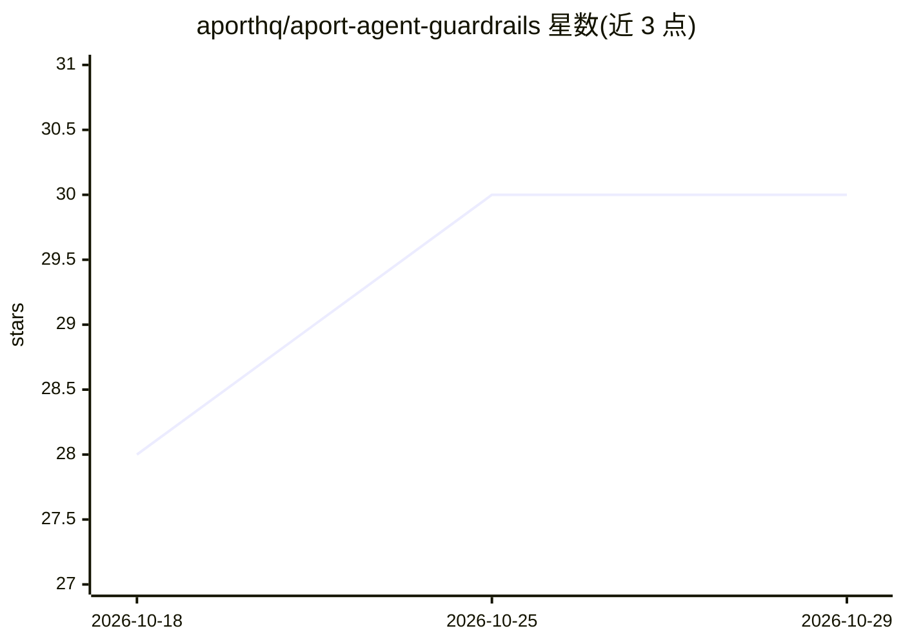

# aporthq/aport-agent-guardrails

⭐ 30 · Shell · NOASSERTION · 推送 2026-10-03 · [GitHub](https://github.com/aporthq/aport-agent-guardrails) · [官网](https://aport.io/frameworks) · 组织维护

**AI agent 工具调用的前置授权护栏，防提示注入绕过策略**

面向 AI agent 的确定性预执行授权工具：在每次工具调用执行前，依据 Open Agent Passport (OAP) 护照与策略上限进行校验，校验失败按 fail-closed 默认拦截，从而将提示注入与误操作风险从运行时行为转为策略配置问题。支持 GitHub 仓库保护（Actions workflow + OIDC）以及 Claude Code、Cursor、LangChain、CrewAI、DeerFlow、OpenClaw、n8n、Codex、Gemini CLI、Goose 等框架的运行时钩子接入，提供 npx/pip 安装与托管或本地护照两种模式，每个 allow/deny 决策带上下文记录。Codex/Gemini/Goose 目标处于 beta 命令钩子阶段，存在多项 fail-closed 限制；托管模式依赖 APort 云端护照。

## 筛选速览

| 维度 | 判定 | 备注 |
|---|---|---|
| AI 角色 | `ai-ecosystem` | LLM/agent 周边工具 |
| 许可风险 | `none` | NOASSERTION |
| 部署形态 | `library` | 以包/库形式分发 |
| 模型依赖 | — | README 未给出锁定关系 |
| 硬件要求 | — | 无带数字的原话,不猜 |
| 安装摩擦 | `low` | 无编译、无系统依赖或容器化 |
| 成熟度 | — | 结构信号不足 |

## 能力要点

- 工具执行前的确定性授权钩子，非提示词指令，fail-closed 默认
- 覆盖 GitHub Actions 仓库保护与十余种 agent 框架的运行时钩子
- Open Agent Passport (OAP) v1.0 开放标准护照与决策格式
- warn/observe 分级 rollout 模式，决策记录可审计

## 适用场景

- 为 Claude Code/Cursor 等 agent 添加工具调用的策略拦截
- 在 GitHub 仓库上对 AI 辅助改动收集 OAP 证据或阻断合并
- 企业 IT 团队对 agent 执行敏感操作（文件/命令/外部调用）做治理

## 场景标签

`网络安全` · 领域:学习与行业

## 证据(README 行号)

> L19: Deterministic pre-action authorization for AI agents. Guardrails run before supported tool execution, so prompt inj
> L132: The security concern is that agent tools and skills can execute sensitive actions (files, commands, external calls
> L140: **Two ways to use APort:** (1) **Guardrails (CLI/setup)** — run the installer to create your passport and config; 

## 星数曲线

2026-10-18 28 → 2026-10-29 30（+2）

---
*卡片 v1 · prompt 1.4 · 生成 2026-10-26 · 置信度 high · 依据 README sha `1a6d639e3c03` · [字段定义](../../DATASET.md)*
