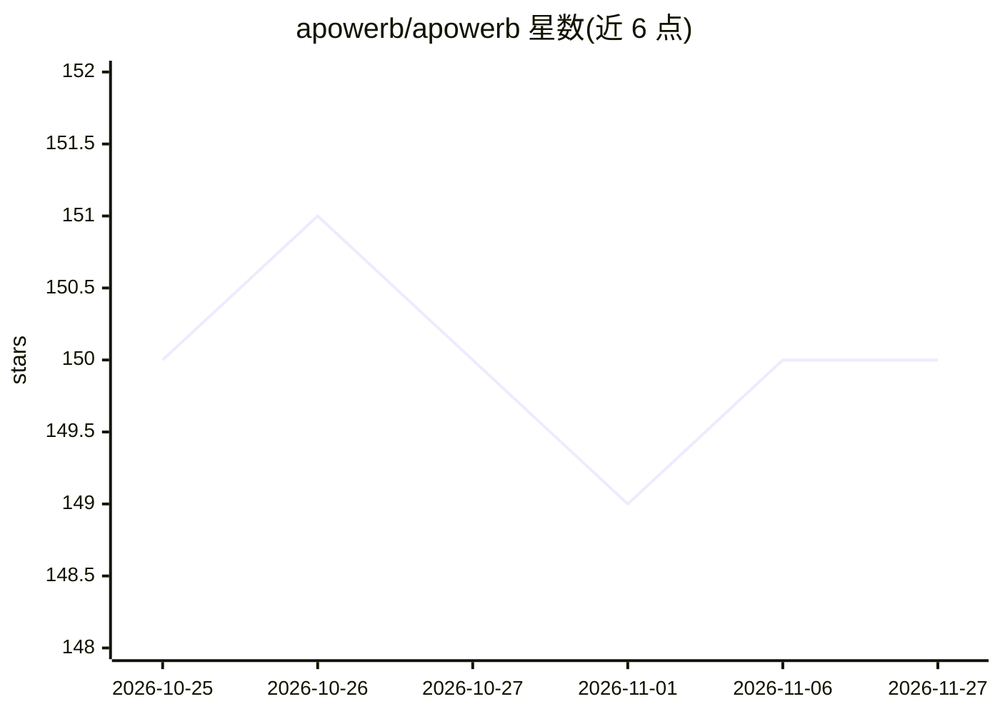

# apowerb/apowerb

⭐ 150 · Python · Apache-2.0 · 推送 2026-11-24 · [GitHub](https://github.com/apowerb/apowerb) · [官网](https://docs.apowerb.com/) · 组织维护

**给开发/运营团队构建、编排与运行生产级 AI agent 的开源框架**

apowerb 是构建、运行和治理生产级 AI agent 的开源平台，核心采用 Apache-2.0，计费、身份提供方登录、MFA、agent 评估等企业模块由 thaink² 单独销售。功能覆盖多 agent 编排（顺序/并行/循环/子 agent）、内置 RAG 与 Text-to-SQL、MCP 服务器接入、邮件与定时触发运行、每用户 token 配额与会话审计。基于 FastAPI、Google ADK 与 LiteLLM 构建，可用 Docker Compose 快速自托管，或从源码配合自有 PostgreSQL 安装。

## 筛选速览

| 维度 | 判定 | 备注 |
|---|---|---|
| AI 角色 | `ai-ecosystem` | LLM/agent 周边工具 |
| 许可风险 | `permissive` | Apache-2.0 |
| 部署形态 | `self-host` | docker 或自建部署 |
| 模型依赖 | — | README 未给出锁定关系 |
| 硬件要求 | — | 无带数字的原话,不猜 |
| 安装摩擦 | `low` | 无编译、无系统依赖或容器化 |
| 成熟度 | — | 结构信号不足 |

## 能力要点

- 多 agent 编排：sequential、parallel、loop 与 sub-agents 组合
- 内置 RAG（文件/URL/数据库/S3）与 Text-to-SQL
- Gmail/Outlook webhook 与 cron 定时触发无人值守运行
- 每用户 token 配额、会话审计、加密密钥与可撤销会话

## 适用场景

- 新邮件到达时自动分类、查 CRM 并起草回复
- 定时用自然语言查询数据库并生成图表报告发邮件
- 基于合同/流程文件搭建 RAG 文档问答助手
- 对话或无人值守地更新 HubSpot/Odoo 等业务系统数据

## 场景标签

`Agent 框架` `多智能体` `RAG` `数据分析` · 领域:Agent 开发

## 证据(README 行号)

> L27: apowerb is an open-source platform to build, run and govern AI agents in
> L47: Built on **FastAPI**, **Google ADK** and **LiteLLM**, so it works with Anthropic,
> L146: - **REST API** based on FastAPI, with a CLI for agent and server management

## 星数曲线

2026-10-25 150 → 2026-11-27 150（+0）

---
*卡片 v1 · prompt 1.4 · 生成 2026-11-27 · 置信度 high · 依据 README sha `32577eca3a36` · [字段定义](../../DATASET.md)*
