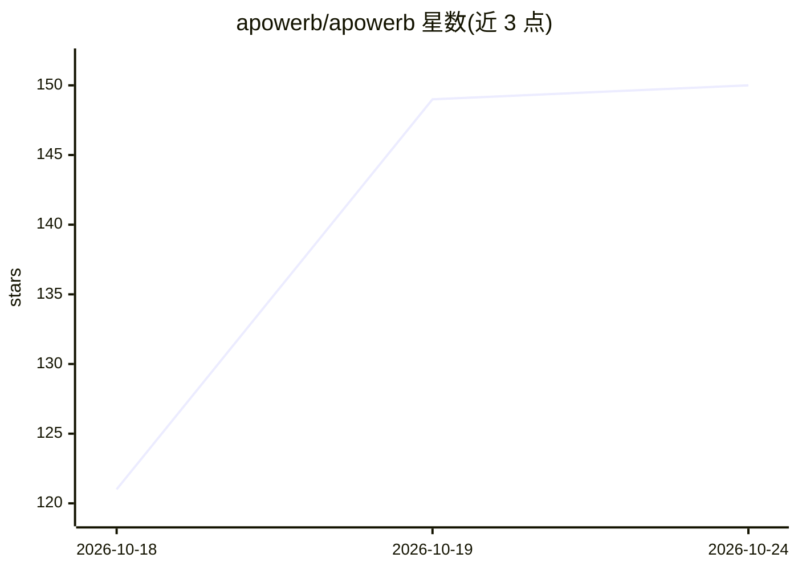

# apowerb/apowerb

⭐ 150 · Python · Apache-2.0 · 推送 2026-10-23 · [GitHub](https://github.com/apowerb/apowerb) · [官网](https://docs.apowerb.com/) · 组织维护

**开源 agent 框架：构建、编排并运维生产级 AI agent**

基于 FastAPI、Google ADK 与 LiteLLM 的自托管 agent 平台：通过 Web 界面或 REST API 定义 agent（顺序/并行/循环/子 agent 编排），内置 RAG、Text-to-SQL、44 个工具模块（Google Workspace、Microsoft 365、GitHub、CRM、数据库等）、MCP server 接入、邮件与定时触发的无人值守运行、会话审计与按用户 token 配额。核心 Apache-2.0，计费、身份登录、MFA、agent 评估等企业模块由 thaink² 另行出售。Quick start 用 Docker Compose 三条命令启动，源码安装需 Python 3.10+、PostgreSQL 与 UV。

## 筛选速览

| 维度 | 判定 | 备注 |
|---|---|---|
| AI 角色 | `ai-ecosystem` | LLM/agent 周边工具 |
| 许可风险 | `permissive` | Apache-2.0 |
| 部署形态 | `self-host` | docker 或自建部署 |
| 模型依赖 | — | README 未给出锁定关系 |
| 硬件要求 | — | 无带数字的原话,不猜 |
| 安装摩擦 | `low` | 无编译、无系统依赖或容器化 |
| 成熟度 | — | 结构信号不足 |

## 能力要点

- 多模式编排（顺序/并行/循环/子 agent）与 MCP server 接入
- 内置 RAG、Text-to-SQL 与 44 个工具模块（M365/Workspace/CRM/数据库）
- 邮件与 cron 触发的无人值守运行，每次运行留审计 trace
- 生产控制：用户/组/权限、按用户 token 配额、可撤销会话、密钥加密

## 适用场景

- 让 agent 在收到新邮件时自动分类、查 CRM 并起草回复
- 定时 agent 用自然语言查数据库生成图表并邮件汇总
- 基于自有合同与流程文件构建文档问答助手

## 场景标签

`Agent 框架` `多智能体` `数据分析` `RAG` · 领域:Agent 开发

## 证据(README 行号)

> L27: apowerb is an open-source platform to build, run and govern AI agents in
> L47: Built on **FastAPI**, **Google ADK** and **LiteLLM**, so it works with Anthropic,
> L30: session audit. You can self-host it with Docker Compose or Helm. The core is

## 星数曲线

2026-10-18 121 → 2026-10-24 150（+29）

---
*卡片 v1 · prompt 1.4 · 生成 2026-10-22 · 置信度 mid · 依据 README sha `5bce2bcda4f4` · [字段定义](../../DATASET.md)*
