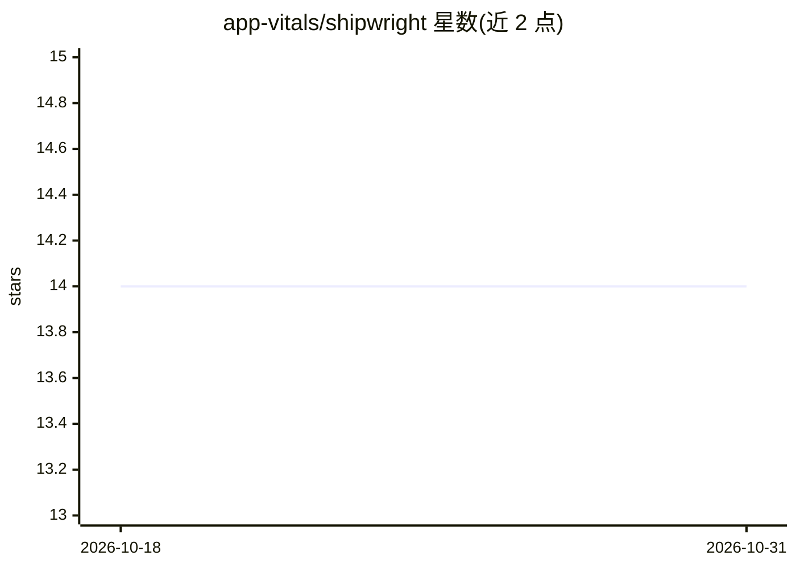

# app-vitals/shipwright

⭐ 14 · TypeScript · MIT · 推送 2026-10-30 · [GitHub](https://github.com/app-vitals/shipwright) · [官网](https://shipwrightharness.com) · 组织维护

**面向 Claude Code 的自主交付 agent：从 PRD 到上线全流程**

构建于 Claude Code 插件体系之上的自主编码与交付系统：以 plan → build → review → ship 命令链将特性想法转化为已评审合并的代码，任务存于共享 task store 供多 agent 消费；含五阶段 test-readiness 流水线与策略化 PR 评审。可交互式在 Claude Code 内使用，也可部署到 GitHub Actions 或自托管环境按计划自主执行；另有读取流水线分析的 metrics dashboard 与 Slack 应用形态。MIT 许可，需 Claude Code 方可运行。

## 筛选速览

| 维度 | 判定 | 备注 |
|---|---|---|
| AI 角色 | `ai-native` | 本体是模型或模型工具 |
| 许可风险 | `permissive` | MIT |
| 部署形态 | `library` | 以包/库形式分发 |
| 模型依赖 | locked-api |  |
| 硬件要求 | — | 无带数字的原话,不猜 |
| 安装摩擦 | `low` | 无编译、无系统依赖或容器化 |
| 成熟度 | — | 结构信号不足 |

## 能力要点

- PRD → 计划 → 任务队列 → 构建 → 评审 → 合并的命令链，各阶段产出持久工件
- 共享 task store 支持多 agent/贡献者协作同一队列
- 五阶段 test-readiness 流水线与策略化 PR 评审
- 可部署至 GitHub Actions/自托管（Helm chart），并提供本地离线 metrics dashboard

## 适用场景

- 在自己的仓库上跑自主编码流水线，自动完成任务并开 PR
- 在 Claude Code 会话内交互式使用计划与评审命令
- 通过 Slack（DM/@提及/cron）驱动 agent 执行任务
- 查看自身交付流水线的周期、CI 首过率与评审指标

## 场景标签

`编码 Agent` `代码审查` `多智能体` · 领域:Agent 开发

## 证据(README 行号)

> L36: - **The agent** — deploy it to your cloud (GitHub Actions or self-hosted). It does autonomous coding on your codeba
> L47: - **Execute** the next ready task — build, test, and open a PR.

## 星数曲线

2026-10-18 14 → 2026-10-31 14（+0）

---
*卡片 v1 · prompt 1.4 · 生成 2026-10-31 · 置信度 high · 依据 README sha `9bc4e436d8a5` · [字段定义](../../DATASET.md)*
