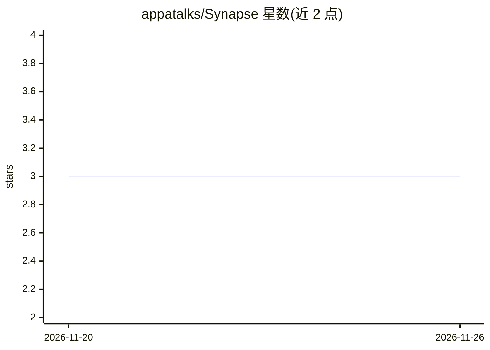

# appatalks/Synapse

⭐ 3 · Python · MIT · 推送 2026-11-19 · [GitHub](https://github.com/appatalks/Synapse) · 个人维护

**在本地硬件上运行 MoE 开放权重模型的桌面应用**

SYNAPSE 将本地聊天、模型控制、硬件监控与 OpenAI 兼容 API 集成到一个应用中，可选的实验性加速在 GPU 与 CPU 之间分配 MoE 专家计算。需要用户提供 GGUF 模型与兼容的 llama-server 后端；Linux 可选构建 NVIDIA 加速后端。README 标注实验性加速未经广泛质量验证，并给出按模型的推荐设置、基准细节、兼容性限制与白皮书链接。提供 Linux/macOS 一行安装脚本与 Windows PowerShell 安装器。

## 筛选速览

| 维度 | 判定 | 备注 |
|---|---|---|
| AI 角色 | `ai-native` | 本体是模型或模型工具 |
| 许可风险 | `permissive` | MIT |
| 部署形态 | `desktop` | 安装包/桌面程序 |
| 模型依赖 | local-ok | 支持本地模型 |
| 硬件要求 | — | 无带数字的原话,不猜 |
| 安装摩擦 | `low` | 无编译、无系统依赖或容器化 |
| 成熟度 | `idea` | |

## 能力要点

- GPU/CPU 混合执行 MoE 模型的可选实验性加速
- 本地 OpenAI 兼容 API，可连接外部应用
- 硬件与生成指标监控面板及 Auto Tune 容量检测
- 支持分片（shard）GGUF 模型的下载与加载

## 适用场景

- 在自己电脑上本地运行超过显存容量的 MoE 模型
- 本地聊天界面管理 GGUF 模型的加载与参数
- 通过本地 API 把本地模型接入其他应用
- 监控推理时的硬件与生成性能指标

## 场景标签

`推理引擎` `聊天机器人` · 领域:对话与助手

## 证据(README 行号)

> L11: SYNAPSE brings local chat, model controls, hardware monitoring and an
> L13: Mixture-of-Experts (MoE) work between the GPU and CPU.
> L21: On one test system, the optional Linux/NVIDIA research backend improved

## 星数曲线

2026-11-20 3 → 2026-11-26 3（+0）

---
*卡片 v1 · prompt 1.4 · 生成 2026-11-22 · 置信度 high · 依据 README sha `76a986d4463e` · [字段定义](../../DATASET.md)*
