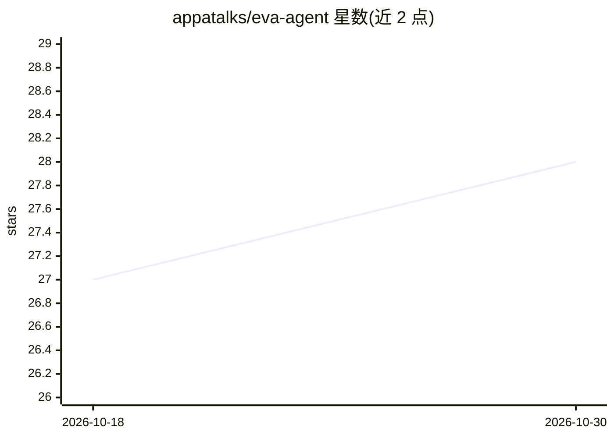

# appatalks/eva-agent

⭐ 28 · Python · MIT · 推送 2026-10-25 · [GitHub](https://github.com/appatalks/eva-agent) · [官网](https://appatalks.github.io/eva-agent/) · 组织维护

**本地优先的桌面 AI 助手：对话、记忆、语音与自动化一体**

桌面端 AI 助手应用：将云端与本地模型统一到同一界面，支持对话、持久记忆、语音、自动化与软件工作。提供统一网关路由 OpenAI、GitHub Copilot ACP、OpenAI 兼容端点（SI Harness）与 MCP 工具；记忆以 SQLite 本地存储并带来源溯源与生命周期控制；内置工作区控制台可监控终端与编码 agent。默认本地优先运行，云服务仅在配置后启用。通过 curl 脚本安装并提供 AppImage 版本。

## 筛选速览

| 维度 | 判定 | 备注 |
|---|---|---|
| AI 角色 | `ai-native` | 本体是模型或模型工具 |
| 许可风险 | `permissive` | MIT |
| 部署形态 | `desktop` | 安装包/桌面程序 |
| 模型依赖 | — | README 未给出锁定关系 |
| 硬件要求 | — | 无带数字的原话,不猜 |
| 安装摩擦 | `low` | 无编译、无系统依赖或容器化 |
| 成熟度 | — | 结构信号不足 |

## 能力要点

- 统一网关路由 OpenAI、GitHub Copilot ACP、OpenAI 兼容端点与 MCP 工具
- 本地 SQLite 持久记忆，带来源溯源、生命周期控制与 Memory Topology 审查界面
- 工作区控制台监控独立终端与编码 agent，可聚焦/中断/下发指令
- 本地优先：默认 SQLite 与本地模型，云服务需显式配置

## 适用场景

- 在一个桌面应用中同时使用云端与本地模型对话
- 管理带来源溯源的个人长期记忆
- 监控和指挥工作区内的终端与编码 agent 任务

## 场景标签

`AI 助手` `Agent 记忆` · 领域:Agent 开发

## 证据(README 行号)

> L5: Eva is a local-first AI assistant for conversation, durable memory, voice, automation,
> L6: and software work. It brings cloud and local models into one focused desktop experience

## 星数曲线

2026-10-18 27 → 2026-10-30 28（+1）

---
*卡片 v1 · prompt 1.4 · 生成 2026-10-26 · 置信度 high · 依据 README sha `41155b81341c` · [字段定义](../../DATASET.md)*
