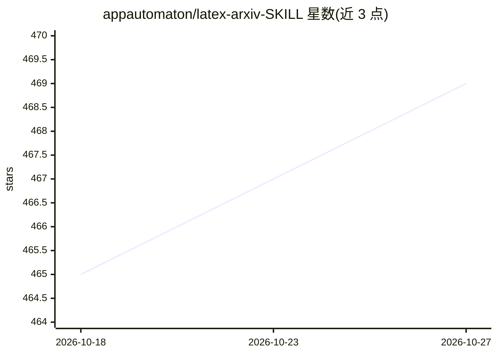

# appautomaton/latex-arxiv-SKILL

⭐ 469 · TeX · MIT · 推送 2026-09-13 · [GitHub](https://github.com/appautomaton/latex-arxiv-SKILL) · [官网](https://appautomaton.com/latex-arxiv-SKILL/) · 个人维护

**驱动编码代理生成 arXiv 就绪综述论文的 Agent Skill**

打包为可移植 Agent Skill 的代理工作流套件：用户向 Claude Code 或 OpenAI Codex 给定主题后，套件驱动代理依次执行文献发现（arXiv Atom API + 本地 SQLite 缓存）、人工审批门、逐 issue 写作循环、引用逐条核验后写入 BibTeX、行文润色与 LaTeX 编译，产出可编译为 PDF 的 IEEEtran 双栏项目。核心限制：需本地 LaTeX 环境（pdflatex/bibtex）、Python 3.8+ 及代理运行时与联网检索；写作进度以 issues CSV 为单一事实来源。附两个完整生成的示例论文。

## 筛选速览

| 维度 | 判定 | 备注 |
|---|---|---|
| AI 角色 | `ai-ecosystem` | LLM/agent 周边工具 |
| 许可风险 | `permissive` | MIT |
| 部署形态 | `None` |  |
| 模型依赖 | — | README 未给出锁定关系 |
| 硬件要求 | — | 无带数字的原话,不猜 |
| 安装摩擦 | `low` | 无编译、无系统依赖或容器化 |
| 成熟度 | — | 结构信号不足 |

## 能力要点

- 主题→文献→审批→逐 issue 写作→引用核验→编译的门控流水线
- 每条 \cite{} 经 web 核对后写入 ref.bib，无证据主张转为 TODO
- 同一技能包双运行时运行于 Claude Code 与 Codex
- 确定性 Python 脚本负责脚手架、issue 生成与 arXiv 发现（SQLite 缓存）

## 适用场景

- 让编码代理按门控流程产出 arXiv 格式的 ML/AI 综述论文
- 对已有 LaTeX 项目做引用审计并修复 ref.bib
- 按逐 issue 跟踪方式管理长文写作进度

## 场景标签

`科研工具` `AI 写作` · 领域:内容生成

## 证据(README 行号)

> L11: > **An agentic harness, packaged as a portable Agent Skill for Claude Code and Codex. It turns a topic into an arXi
> L13: **arXiv Review Paper Harness** is an agentic harness for writing machine-learning and AI **review papers** in LaTeX
> L32: - **Dual-runtime:** one skill bundle that runs in both Claude Code and Codex.

## 星数曲线

2026-10-18 465 → 2026-10-27 469（+4）

---
*卡片 v1 · prompt 1.4 · 生成 2026-10-23 · 置信度 high · 依据 README sha `72746b9d065d` · [字段定义](../../DATASET.md)*
