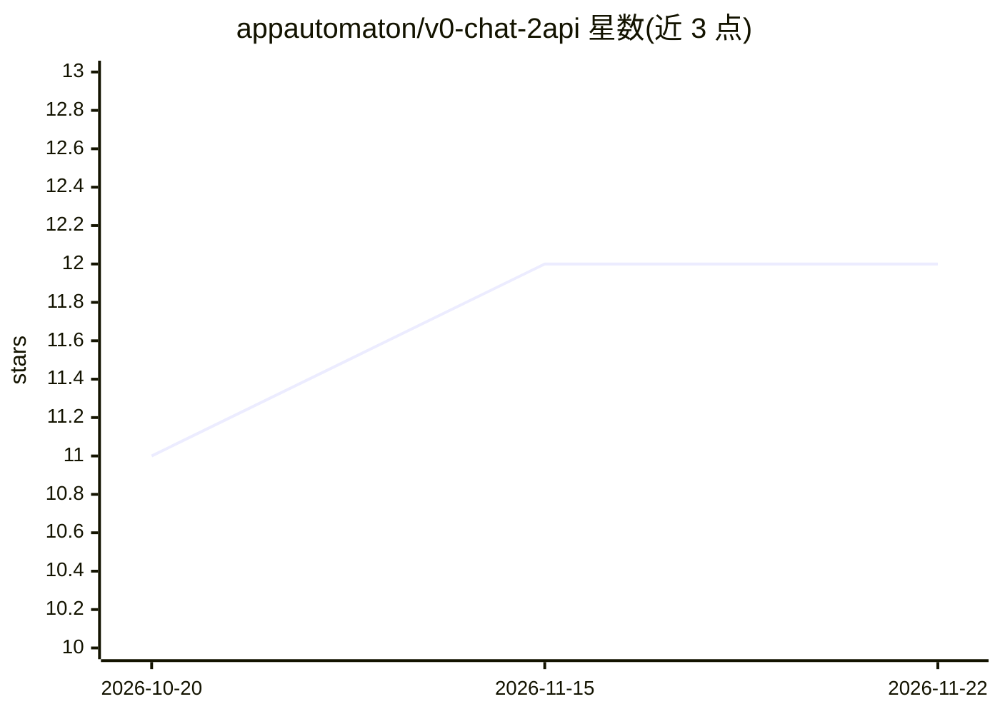

# appautomaton/v0-chat-2api

⭐ 12 · TypeScript · 推送 2026-03-06 · [GitHub](https://github.com/appautomaton/v0-chat-2api) · 个人维护

**将 Vercel v0 聊天封装为本地 OpenAI 兼容 API 的代理**

本地运行的 Fastify 代理服务器，把 Vercel v0 的 chats API 暴露为 OpenAI 风格的 /v1/chat/completions 接口，供 OpenAI 兼容客户端接入。通过前缀哈希匹配本地对话映射以复用上游 chatId，历史不匹配时将早前轮次序列化进 system 上下文新建上游会话；对话状态持久化到 SQLite，并附带 Overview/Usage/Conversations 三个页面的仪表盘。面向需要在本地以 OpenAI 协议调用 v0 的开发者。

## 筛选速览

| 维度 | 判定 | 备注 |
|---|---|---|
| AI 角色 | `ai-ecosystem` | LLM/agent 周边工具 |
| 许可风险 | `none` | — |
| 部署形态 | `library` | 以包/库形式分发 |
| 模型依赖 | — | README 未给出锁定关系 |
| 硬件要求 | — | 无带数字的原话,不猜 |
| 安装摩擦 | `low` | 无编译、无系统依赖或容器化 |
| 成熟度 | — | 结构信号不足 |

## 能力要点

- 暴露 /v1/chat/completions 与 /v1/models 等 OpenAI 兼容端点
- SQLite 持久化本地对话映射，前缀哈希匹配续接上游 chatId
- 回退新建会话时将历史轮次序列化进 system 上下文转发
- 内置仪表盘展示状态、用量与合并后的完整对话记录

## 适用场景

- 让 OpenAI 兼容客户端通过本地代理调用 v0 模型
- 在本地检查与审计与 v0 的完整对话历史
- 查看 v0 余额、速率限制与近期用量事件

## 场景标签

`模型网关` · 领域:Agent 开发

## 证据(README 行号)

> L3: Local OpenAI-compatible proxy for Vercel v0 `chats`.
> L9: - Accepts `POST /v1/chat/completions`
> L89: - Base URL: `http://localhost:3000/v1`

## 星数曲线

2026-10-20 11 → 2026-11-22 12（+1）

---
*卡片 v1 · prompt 1.4 · 生成 2026-11-18 · 置信度 high · 依据 README sha `29c791f7cab6` · [字段定义](../../DATASET.md)*
