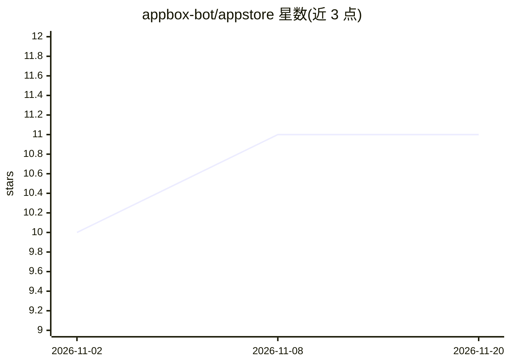

# appbox-bot/appstore

⭐ 11 · Python · 推送 2026-11-06 · [GitHub](https://github.com/appbox-bot/appstore) · 个人维护 · 中文 README

**第三方应用推荐清单：视频/图片/游戏类 app 目录**

以表格形式维护的第三方应用推荐合集，覆盖开源自编译、边缘、灰色等应用，按 Videos、Images、Games 等分类组织条目，每条列出应用名称、下载地址与描述。条目以 Android 为主，部分提供多平台下载或源码链接。README 未见安装命令、构建说明与维护者身份信息，鼓励社区参与更新。

## 筛选速览

| 维度 | 判定 | 备注 |
|---|---|---|
| AI 角色 | `ai-knowledge` | 知识聚合/清单类 |
| 许可风险 | `none` | — |
| 部署形态 | `None` |  |
| 模型依赖 | — | README 未给出锁定关系 |
| 硬件要求 | — | 无带数字的原话,不猜 |
| 安装摩擦 | `low` | 无编译、无系统依赖或容器化 |
| 成熟度 | — | 结构信号不足 |

## 能力要点

- 按 Videos/Images/Games 等类别组织的表格化应用清单
- 条目含下载地址与功能描述，覆盖开源、边缘与灰色应用
- 收录 Flutter 客户端、Pixiv 第三方客户端等开源项目

## 适用场景

- 查找 Android 端第三方视频与壁纸应用
- 寻找 Pixiv、itch.io 等平台的第三方客户端
- 浏览游戏翻译工具等桌面应用

## 场景标签

`精选清单` · 领域:学习与行业

## 证据(README 行号)

> L3: 本库致力于做第三方应用推荐。包括但不限于开源自编译、边缘、灰色等app，欢迎大家参与更新。
> L7: |序号|应用名称|预览图|下载地址|描述|

## 星数曲线

2026-11-02 10 → 2026-11-20 11（+1）

---
*卡片 v1 · prompt 1.4 · 生成 2026-11-18 · 置信度 high · 依据 README sha `11fb55775d01` · [字段定义](../../DATASET.md)*
