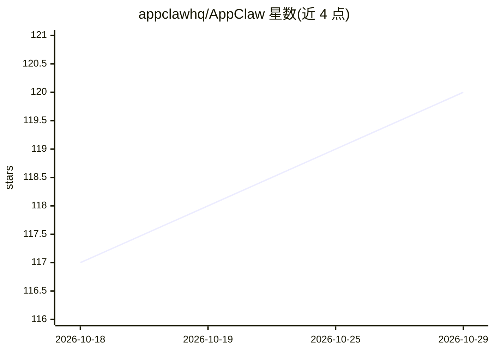

# appclawhq/AppClaw

⭐ 120 · TypeScript · Apache-2.0 · 推送 2026-09-03 · [GitHub](https://github.com/appclawhq/AppClaw) · [官网](https://appclaw.in/) · 组织维护

**面向 Android/iOS 的自然语言移动自动化 Agent，LLM 驱动设备操作**

开源移动自动化代理：用自然语言描述目标，由 LLM 读取屏幕并驱动 Android/iOS 设备完成点击、输入、滑动；同时提供零 LLM 的确定性 YAML 流程、vitest 风格测试运行器（appclaw test）、SDK 无头引擎与终端内的 Terminal Studio（含设备镜像与步骤录制导出）。LLM 可选 Anthropic/OpenAI/Google/Groq 或本地 Ollama，需 Node.js 22+ 与连接的设备/模拟器。以 npm CLI 与 npm 包形式安装，Apache-2.0 许可。

## 筛选速览

| 维度 | 判定 | 备注 |
|---|---|---|
| AI 角色 | `ai-native` | 本体是模型或模型工具 |
| 许可风险 | `permissive` | Apache-2.0 |
| 部署形态 | `library` | 以包/库形式分发 |
| 模型依赖 | local-ok | 支持本地模型 |
| 硬件要求 | — | 无带数字的原话,不猜 |
| 安装摩擦 | `low` | 无编译、无系统依赖或容器化 |
| 成熟度 | — | 结构信号不足 |

## 能力要点

- 自然语言目标驱动设备操作（tap/type/swipe），LLM 供应商可选含本地 Ollama
- 零 LLM 的 YAML 确定性流程（结构化选择器与状态断言）
- vitest 风格跨真机测试运行器与 vitest/jest/mocha SDK
- Terminal Studio：终端内设备镜像与步骤录制，/export 导出可运行 spec

## 适用场景

- 用一句话让 Agent 在手机上完成操作（如发 WhatsApp 消息）
- 编写确定性的移动端 UI 自动化流程
- 在真机/模拟器上运行端到端测试并集成到现有测试框架

## 场景标签

`GUI 自动化` `工作流自动化` · 领域:效率与自动化

## 证据(README 行号)

> L3:  AI-powered mobile automation agent for Android and iOS. Tell it what to do in plain English — it figures out what t
> L32: - **Agent mode** — plain-English goals; the LLM drives the device (tap, type, swipe)
> L24: You'll need **Node.js 22+**, a connected device / emulator / simulator, and an **LLM API key** (Anthropic, OpenAI, 

## 星数曲线

2026-10-18 117 → 2026-10-29 120（+3）

---
*卡片 v1 · prompt 1.4 · 生成 2026-10-23 · 置信度 high · 依据 README sha `213efbfd6bfa` · [字段定义](../../DATASET.md)*
