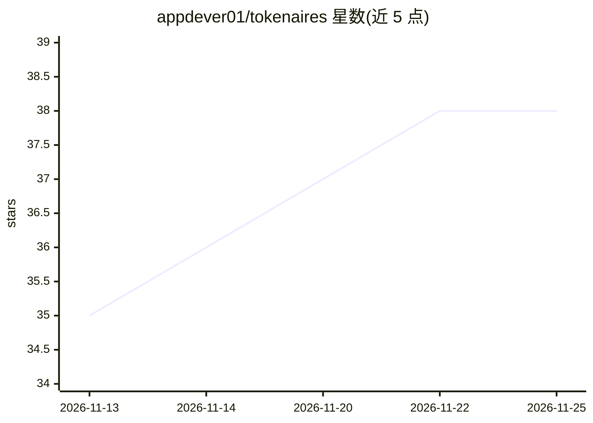

# appdever01/tokenaires

⭐ 38 · MIT · 推送 2026-11-20 · [GitHub](https://github.com/appdever01/tokenaires) · [官网](https://tokenaires.cc) · 个人维护

**按 AI token 消耗量给开发者排名的 CLI 与榜单**

面向使用编码 agent 的开发者的 token 消耗排行榜：CLI 通过 GitHub 短码登录，读取本机 Claude Code、Codex、Gemini CLI 等 15 种编码 agent 已有的使用日志，统计 token 数并上传至服务器汇总排名，设有 1K 到 1T 的四档称号。支持仅本地统计不上传的 scan 模式与每 6 小时自动同步；上传内容不含提示词、代码与文件路径，服务器端核算并由设备密钥签名防作弊。需要 Node.js 22.15+，仓库以多分支形式组织前后端与 CLI 供贡献者本地运行。

## 筛选速览

| 维度 | 判定 | 备注 |
|---|---|---|
| AI 角色 | `ai-ecosystem` | LLM/agent 周边工具 |
| 许可风险 | `permissive` | MIT |
| 部署形态 | `library` | 以包/库形式分发 |
| 模型依赖 | — | README 未给出锁定关系 |
| 硬件要求 | — | 无带数字的原话,不猜 |
| 安装摩擦 | `low` | 无编译、无系统依赖或容器化 |
| 成熟度 | — | 结构信号不足 |

## 能力要点

- 读取本机 agent 使用日志统计 token 并上传排名
- 支持 15 种编码 agent（Claude Code、Codex、Gemini CLI 等）
- scan 模式仅本地打印总量不上传
- 设备密钥签名与服务器端核算防作弊机制

## 适用场景

- 查看自己在各编码 agent 上的 token 消耗排名
- 本地统计 AI 编码工具的 token 用量而不上传数据
- 与排行榜上其他开发者比较 token 消耗

## 场景标签

 · 领域:开发者工具/AI 使用统计

## 证据(README 行号)

> L27: |**2**|**Scan**|The CLI reads the usage logs your agents already keep on your machine.|
> L18: npx tokenaires signs you in with GitHub, scans your agent logs, uploads token counts and shows your rank

## 星数曲线

2026-11-13 35 → 2026-11-25 38（+3）

---
*卡片 v1 · prompt 1.4 · 生成 2026-11-18 · 置信度 high · 依据 README sha `88e5dfda1512` · [字段定义](../../DATASET.md)*
