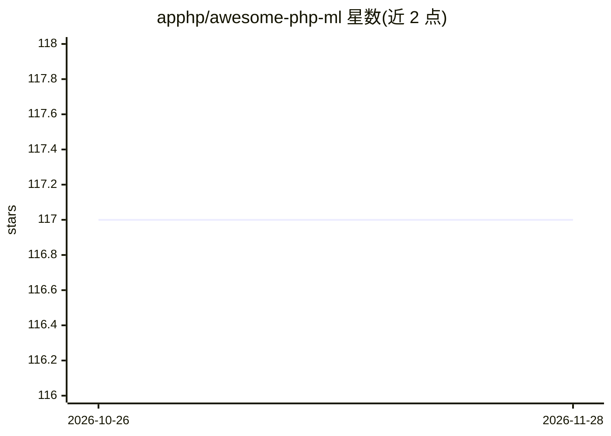

# apphp/awesome-php-ml

⭐ 117 · PHP · MIT · 推送 2026-11-12 · [GitHub](https://github.com/apphp/awesome-php-ml) · [官网](https://apphp.github.io/awesome-php-ml/) · 组织维护

**PHP 开发者的机器学习与 AI 库策展清单**

面向 PHP 开发者的资源清单，收录机器学习、深度学习、NLP、计算机视觉、数值计算、ONNX 推理运行时及 LLM API 客户端等类别的 PHP 库与工具。按领域分类组织，标注 🌟/🧪/⚠️ 维护状态标记，提供按任务选库的使用指南、Quick Start 的 composer 安装命令与示例配方，并列出 PHP 版本与扩展要求。自身为清单项目，不包含可运行的模型或软件。

## 筛选速览

| 维度 | 判定 | 备注 |
|---|---|---|
| AI 角色 | `ai-knowledge` | 知识聚合/清单类 |
| 许可风险 | `permissive` | MIT |
| 部署形态 | `None` |  |
| 模型依赖 | — | README 未给出锁定关系 |
| 硬件要求 | — | 无带数字的原话,不猜 |
| 安装摩擦 | `low` | 无编译、无系统依赖或容器化 |
| 成熟度 | — | 结构信号不足 |

## 能力要点

- 按 ML/深度学习/NLP/CV/数学/推理运行时/LLM API 等类别组织的策展清单
- 提供按目标任务的选库指南与示例配方（RAG、翻译、视觉等）
- Quick Start 给出 rubix/ml、php-ai/phpml 的 composer 安装命令
- 条目带 🌟/🧪/⚠️ 状态标记

## 适用场景

- 为 PHP 项目寻找分类、回归等传统机器学习库
- 在 Laravel/Symfony 应用中接入 LLM API 与 RAG 流程
- 查找从 PHP 运行 ONNX/GGUF 模型的推理方案

## 场景标签

`精选清单` · 领域:学习与行业

## 证据(README 行号)

> L10: The most comprehensive curated list of **Machine Learning, Artificial Intelligence, NLP, LLM and Data Science libra
> L38: - Curated list of **PHP libraries and tools** for Machine Learning, AI, NLP, LLMs and Data Science.
> L39: - Focused on **code-first resources**: packages, SDKs, frameworks, and building blocks.

## 星数曲线

2026-10-26 117 → 2026-11-28 117（+0）

---
*卡片 v1 · prompt 1.4 · 生成 2026-11-28 · 置信度 high · 依据 README sha `9797128ff84c` · [字段定义](../../DATASET.md)*
